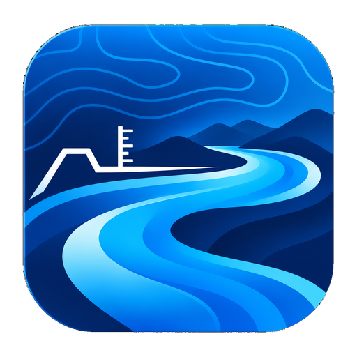

<p align="center">
  
</p>

<h1 align="center">De-RAS</h1>

<p align="center"><strong>A modern, beginner-friendly river hydraulics modeling suite, inspired by HEC-RAS.</strong></p>


> **Status: pre-alpha, in design.** Nothing here is stable yet. APIs, file formats and the feature list will change.

---

## Overview

De-RAS is an open hydraulic modeling tool for river and floodplain analysis. It covers the same ground as established tools such as HEC-RAS (water surface profiles, flood levels, inundation mapping), with two priorities:

1. **A modern workflow.** Clean interface, readable project files, scriptable from the command line, and sensible defaults.
2. **Easy to learn.** Guided setup, plain-language validation messages, and built-in checks that catch common modeling mistakes before a run, not after.

De-RAS is aimed at engineers, students and practitioners who need reliable flood-level results without a steep learning curve.

## Why De-RAS

| Area | Goal |
| --- | --- |
| Onboarding | Step-by-step project wizard: geometry, flow, boundary conditions, run |
| Validation | Pre-run checks with clear explanations (units, datum, station order, missing data) |
| Transparency | Human-readable project files that work well with version control |
| Interoperability | Import and export common GIS and CAD formats (GeoJSON, Shapefile, DXF/DWG exchange, GeoTIFF) |
| Automation | Every action available from a CLI and a Python API |
| Units | SI by default, with explicit datum and CRS stated on every table and map |

## Planned capabilities

Scope is staged. See [`docs/ROADMAP.md`](docs/ROADMAP.md) for details.

- [ ] Cross-section and reach geometry editor
- [ ] 1D steady flow, gradually varied flow (standard step method)
- [ ] Design profiles for multiple return periods
- [ ] Boundary conditions: known water surface, critical depth, normal depth
- [ ] Results viewer: profile plots, cross-section plots, summary tables
- [ ] Terrain-based inundation mapping (depth, water surface elevation, velocity)
- [ ] 1D unsteady flow
- [ ] Calibration and validation helpers
- [ ] 2D flow areas

Items are goals, not commitments.

## Repository layout

```
De-RAS/
├── src/                 Application and solver source code
├── tests/               Automated tests and verification cases
├── examples/            Sample projects for learning and benchmarking
├── docs/                Documentation, design notes and roadmap
│   ├── assets/          Logo, images and diagrams used in the docs
│   └── reverse-engineering/   REA process guide (English and Indonesian, Word)
├── .github/             Issue and pull request templates
├── CHANGELOG.md
├── CONTRIBUTING.md
└── README.md
```

## Getting started

Installation and usage instructions will be added once the first runnable build exists.

```text
# placeholder
pip install de-ras        # name and method to be confirmed
de-ras --help
```

## Verification

Hydraulic results will be checked against analytical solutions and published benchmark problems. Verification cases live in `tests/` and are run in CI.

## Independence and attribution

De-RAS is an independent project. It is **not affiliated with or endorsed by** the U.S. Army Corps of Engineers or the HEC-RAS software. "HEC-RAS" is named only to describe the type of problem De-RAS addresses and to document file-format compatibility goals.

De-RAS is built from published hydraulic theory, public documentation, and written specifications of observed software behavior. Specifications are produced under a clean-room process in which implementers never see the analysed software's code. The process is described in [`docs/reverse-engineering/`](docs/reverse-engineering/). No third-party code, binaries or assets are included in this repository.

## Contributing

The project is private and in early design. Contribution guidelines are in [`CONTRIBUTING.md`](CONTRIBUTING.md).

## License

To be decided before the first public release.

## Maintainer

Faishal Aptana Azmi, Tarakan, Indonesia.
