# 1. About this manual

De-RAS is a river and floodplain hydraulics program. It computes water surface profiles, flood extents, and flow velocities with its own computation engine, written from the equations in the publicly available HEC-RAS technical documentation. De-RAS stores projects in the HEC-RAS file format (versions 6.x and 7.0.x), so HEC-RAS projects open directly and De-RAS projects can be handed straight to HEC-RAS users. Agreement between De-RAS and HEC-RAS results is stated per feature, and only after that feature has been validated (see Chapter 18).

The De-RAS window is kept simple: a menu bar, a toolbar grouped by stage of work, and one work area. Every editor opens in **one window that changes its view**, not in separate windows. Only computation and help use windows of their own.

This manual covers the whole process in order:

1. Preparation: hardware, data, and knowledge you need (Chapter 2).
2. Installation and checking it (Chapter 3).
3. Getting to know the De-RAS window (Chapter 4).
4. A complete 1D steady flood study, step by step, from a new project to results and a report (Chapters 5 to 11).
5. Unsteady flow, 2D areas, sediment, water quality, hydraulic design, calibration, autosave, and unit conversion (Chapters 12 to 17).
6. Working with HEC-RAS, quality checks, troubleshooting, updates, and appendices (Chapters 18 to 21 and the appendices).

## 1.1 Feature status and versions

De-RAS is built in stages. Inside the program every feature carries one of the following labels, and **Help › Feature matrix** lists them all.

| Label | Meaning |
|---|---|
| Done | Built, passes unit tests and benchmarks, and has ⓘ help. |
| Preview | Usable, but validation is not complete. Plots, tables, maps, and reports from this feature are marked "Preview — not validated". |
| Partial | Part of the feature works; the parts that do not are named. |
| Not available yet | Not built. If a button exists, it is dimmed with a lock icon and its tooltip names the plan. |

"Done" does not mean the results match HEC-RAS. Agreement with HEC-RAS is recorded separately in the Feature matrix. As of this edition, no feature has been compared with HEC-RAS yet. Every new feature in 0.2.3 carries the Preview label.

Each chapter names the version or milestone in which a feature is available:

| Version / milestone | What you can do |
|---|---|
| 0.1.0 | Create, open, and save HEC-RAS projects (.prj, .g##, .f##, .p##). Enter cross sections by hand or from a survey CSV. Compute subcritical steady flow. View results in tables and plots, export CSV and an HTML report. Old UI with a command ribbon. |
| 0.2.0 | The new single-window UI described in this manual, with every 0.1.0 function, plus drawing reaches on the schematic, managing reaches, new geometry/flow/plan files, the general profile, and the detailed table. The computation engine is the same as in 0.1.0. |
| 0.2.1 | Fixes from the 0.2.0 review: a Home button on the toolbar, more reliable Back/Forward, a Model Doctor pop-up that names each error, a new example project (the 1 km standard test project), Dark Theme/Light Theme names, English as the default language, clearer Indonesian text, and a light-blue Light Theme. |
| 0.2.2 | M2 to M5 in one build, all **Preview**. M2: supercritical and mixed flow, upstream boundaries, junctions, rating curves, ineffective areas/levees/obstructions included in the computation, results also written to .p##.hdf files. M3: **RAS Mapper** with projection, GeoTIFF terrain, background pictures, cutting cross sections from terrain, steady inundation maps, GeoTIFF/PNG export, and the 3D perspective. M4: bridges, culverts, and inline structures (weir crest and gates) for subcritical steady flow. M5: 1D unsteady flow, hydrographs, and time series. |
| 0.2.3 (current build) | M6 to M8 in one build, all **Preview**. M6: storage areas, SA/2D connections, lateral structures (with an optional breach), pump stations, and 2D flow areas on a square grid with depth, velocity, and arrival-time maps; all computed in Unsteady Analysis. M7: Quasi-unsteady Flow Data, Sediment Data, and Sediment Analysis. M8: autosave and recovery, Word and PDF reports, Hydraulic Design (uniform flow and HEC-18 bridge scour), Manning's n calibration, Water Quality, and project unit conversion SI ↔ US. Also the fixes for findings T3 to T7. |
| Not built | Vertical n, multiple bridge openings, HEC-RAS `.hdf` terrain, map reprojection, online base maps, `.hdf` files for unsteady results, bridge and inline structures in unsteady runs, 2D polygon meshes, the Shallow Water equations, animation, breaklines, and Manning's n regions. Not scheduled yet; the order is decided before the next build. |
| Optional | Catchment hydrology module (rainfall–runoff). Until it exists, prepare hydrographs with a separate hydrological analysis and enter them as data. |

> STATUS: The build available when this edition was written is 0.2.3, the fourth test build. The M2 to M8 features can be used with the Preview label: their results have not been compared with HEC-RAS, and some file parts (structure blocks in `.g##`, Rating Curve and lateral inflow lines in `.u##`, `.p##.hdf` files) have never been opened in HEC-RAS. Parts that are not built are named in the table above and in the relevant chapters. The Windows build has never been run on Windows; the tests on a real laptop listed in `docs/TESTING_EN.md` have not been done yet. The changelog (`docs/CHANGELOG_EN.md`) names what each build contains, and `screenshots/<version>/` holds its screenshots.

## 1.2 Conventions

- Menu commands are written as **Menu › Command**, for example **File › New project**.
- Toolbar buttons are written as **GROUP › Button**, for example **EDITOR › Geometry**.
- Parts of a view are written as **View › Part**, for example **Geometric Data › Cross Section**.
- File names and typed values are shown `like this`.
- Examples use SI units (metres, m³/s). Every step works the same in US Customary units.
- Decimals are typed with a point (for example `0.035`).

# 2. Preparation

Most problems in a hydraulic model come from the input data, not from the software. Collect and check the items in this chapter before opening De-RAS.

## 2.1 Computer requirements

| Component | Minimum | Recommended |
|---|---|---|
| Operating system | Windows 10 64-bit (22H2) | Windows 11 64-bit |
| Processor | 64-bit, 4 cores | 8 cores or more (2D models use all cores) |
| Memory (RAM) | 8 GB | 16–32 GB for 2D models |
| Storage | 1 GB for the program | SSD with 50 GB or more free for projects and terrain |
| Display | 1366 × 768 | 1920 × 1080 or larger |
| Rights | Administrator rights for the installer | Same (the portable version needs no administrator rights) |

## 2.2 Data checklist

Collect the following before building a model. The **Required** column refers to a 1D steady study.

| Data | Required | Typical source and format |
|---|---|---|
| Surveyed cross sections | Yes | Field survey (station–elevation tables, CSV/Excel) or echo sounding. |
| Terrain (DEM) | For maps | LiDAR, drone, or a national DEM in GeoTIFF. In Indonesia, DEMNAS from the Geospatial Information Agency is a common starting point. 1–10 m resolution. A DEM alone does not show the riverbed below water. |
| Coordinate system | For maps | A projected system in metres, for example WGS 84 / UTM zone 49S (EPSG:32749). Know the vertical datum of every elevation source. |
| River centreline, banks | For maps | Digitised from imagery or survey. For now the centreline is drawn in Geometric Data and cross-section cut lines are made in RAS Mapper. Shapefile and GeoPackage import is not available yet. |
| Land cover / roughness | Yes | Field observation, land-cover maps, and a Manning's n table (Appendix B). |
| Design discharges | Yes | Hydrologic analysis outside De-RAS, for example peak flows for 2, 5, 10, 25, 50, and 100-year return periods. |
| Downstream boundary information | Yes | Bed slope near the downstream end, a known water level (sea, lake, confluence), or a rating curve. |
| Hydraulic structures | If present | Bridges, culverts, weirs: dimensions, deck and pier geometry, invert levels, photos. |
| Hydrographs | Unsteady only | Flow or stage time series. For now values are typed or pasted from Excel into the table; HEC-DSS import is not available yet. |
| Sediment data | Sediment only | Bed gradation (percent finer against diameter), measured sediment loads, and a long-term flow series. De-RAS uses one reach and one grain size (d50). |
| Water quality data | Water quality only | Upstream concentration over time, initial concentration, dispersion coefficient, and decay rate (if the substance decays). One substance in mg/L. |
| Bridge scour data | Design only | Pier width, length, shape, and angle; contraction width; abutment length; bed D50. |
| Calibration data | Recommended | High-water marks, gauge records, flood photos. |

## 2.3 Preparing the data

1. Keep all study data in one folder with a short path and no special characters, for example `D:\Projects\RiverX\data`.
2. Reproject all layers to the same projected coordinate system in QGIS. RAS Mapper cannot reproject data yet.
3. Make sure all elevations use the same vertical datum.
4. Clip the DEM to the study area plus a margin at least as wide as the expected floodplain.
5. Check surveyed cross sections: stations increase from left to right looking downstream, with no duplicate points.
6. Record the Manning's n value for each land-cover class and the reason for it.

> TIP: Keep a short data log (source, date, coordinate system, datum, processing steps) in the project Description or in the report.

## 2.4 Recommended knowledge

Users should understand basic open-channel hydraulics (energy equation, Manning's equation, subcritical and supercritical flow) and basic GIS. HEC-RAS users will find the same window layout, terms, and data.

# 3. Installation

## 3.1 What to install

| Software | Needed? | Purpose |
|---|---|---|
| **De-RAS installer** (`De-RAS-<version>-setup-x64.exe`) or the portable version (`De-RAS-<version>-win64-portable.zip`) | Required, choose one | Program, computation engine, help, and every runtime library. Nothing else must be installed. |
| QGIS (Long Term Release) | Optional | Preparing and checking GIS data and laying out final maps. |
| HEC-RAS 7.0.x | Optional | Free from the Hydrologic Engineering Center, U.S. Army Corps of Engineers. Used to compare results or for features De-RAS does not have yet. |
| HEC-DSSVue | Optional | Viewing and editing HEC-DSS time-series files. |
| Microsoft Excel or LibreOffice Calc | Optional | Preparing tables and opening exported CSV files. |

> NOTE: HEC-RAS does not need to be installed to use De-RAS. De-RAS reads and writes project files on its own.

## 3.2 Installing De-RAS

1. Close De-RAS if it is running.
2. Double-click `De-RAS-<version>-setup-x64.exe`. Windows asks for administrator permission; choose **Yes**. If Windows SmartScreen appears, choose **More info › Run anyway** only if the file comes from a source you trust.
3. Choose the installer language. English is the default; Indonesian is also available.
4. If an older De-RAS is installed, the installer shows its version and asks: **Yes** removes the old version and continues, **No** installs without removing it, **Cancel** quits. Your projects and data are not deleted, and HEC-RAS and other programs are not touched.
5. Read the licence notice and continue.
6. Choose the installation folder (default `C:\Program Files\De-RAS`).
7. Choose components: **De-RAS (application and compute engine)** is required; **Start Menu shortcut** and **Desktop shortcut** are optional.
8. Click **Install**, wait until it finishes, then click **Finish**. Tick **Run De-RAS** to open it straight away.

## 3.3 Portable version

Extract `De-RAS-<version>-win64-portable.zip` to a folder you can write to, for example `D:\Apps\De-RAS`, and run `De-RAS.exe`. The portable version creates no shortcuts or Windows app entry; delete the folder to remove it.

## 3.4 Opening De-RAS and the splash screen

Open De-RAS from the desktop shortcut or the Start menu. Before the main window opens, a **splash screen** appears in the centre of the screen while De-RAS loads:

- A borderless window with an animated background of terrain contours and river flow in the De-RAS logo colours.
- Top left: the De-RAS logo, the name **De-RAS**, the version number, and the release label (for example ALPHA).
- Bottom: a dark status bar with the startup step in progress and a progress bar.

The message and the progress bar follow the real startup steps. The splash screen closes by itself when the main window is ready. If animations are turned off in Windows settings, De-RAS shows a still background.

> CAUTION: If startup fails, the splash screen stays open and shows the cause and how to fix it, for example by reinstalling De-RAS. See Chapter 20.

## 3.5 First start

On first start De-RAS shows the **Pilih bahasa / Choose language** sheet. English is listed first and is the default; choose **Bahasa Indonesia** if you prefer Indonesian, then click **Lanjut / Continue**. You can change it at any time in **Options › Appearance › Language**; menus, messages, help, and reports switch without closing the project or discarding edits. The status bar shows the active language (ID or EN).

Theme, font size, and project settings are set in the **Options** view (Chapter 4.10).

## 3.6 Checking the installation

1. Open **Help › About De-RAS** and note the version number.
2. On Home, click **Example project**. The **EXAMPLE** label appears in the title bar so that it is not confused with your own projects.
3. Click **RUN › Steady Analysis** (Ctrl+5), then **Compute (F5)**. The Compute Window opens and the run must finish without errors.
4. Click **View results** and check that the water surface profile appears.

# 4. Getting to know the De-RAS window

## 4.1 One window that changes its view

De-RAS uses **one main window**. When you open Geometric Data, Steady Flow Data, Unsteady Flow Data, Quasi-unsteady Flow Data, Sediment Data, Water Quality Data, Steady Flow Analysis, Unsteady Flow Analysis, Sediment Analysis, Water Quality Analysis, Hydraulic Design, RAS Mapper, Results, or Options, the content of the main window switches to that **view**. Editor windows do not pile up as they do in HEC-RAS. To go back, click **Back** in the view bar or press **Alt+←**. To jump straight to Home, click the **Home** button (house icon) at the left end of the toolbar or press **Ctrl+1**.

Only two windows open separately:

- The **Compute Window**, when you run a computation (Chapter 9.3).
- The **Help window**, when an ⓘ explanation needs a full page or you press **F1** (Chapter 4.7).

Other input, such as **New project**, the project description, managing reaches, junctions, bridges and other structures, the reach-length table, profile names, boundary conditions, the map projection, the Model Doctor pop-up, and save confirmations, appears as a **sheet** inside the main window. Press **Cancel** or **Esc** to close a sheet. Opening and saving files still uses the normal Windows file dialogs.

## 4.2 Parts of the main window

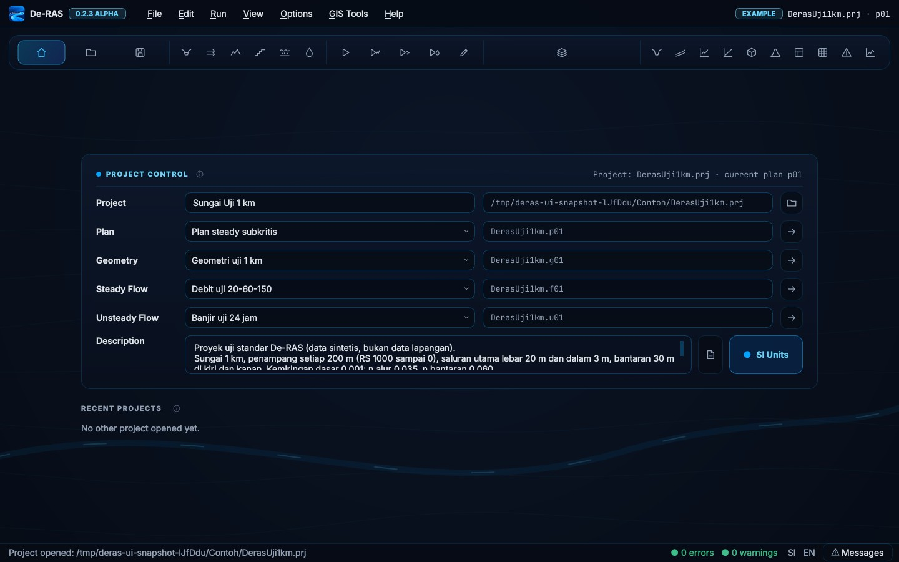

| Part | Purpose |
|---|---|
| Title bar | De-RAS logo, program name, version badge (for example **0.2.3 ALPHA**), the menu bar, the **EXAMPLE** label when the example project is open, and on the right the project file name and active plan. The menus, logo, and name sit on one centred line. |
| Menu bar | **File · Edit · Run · View · Options · GIS Tools · Help**. |
| Toolbar | The most used buttons, grouped by stage of work (Chapter 4.3). Buttons have text labels when the window is wide enough. When it is narrower, locked buttons show as icons only first, then all buttons (at a width of 1440 pixels every button is already an icon). The name still appears as a tooltip. |
| View bar | Back button, breadcrumb (for example *Home › Geometric Data › Cross section RS 1000*), view title, ⓘ, and the view's main action on the right (for example **Save geometry** or **Compute (F5)**). Not shown on Home. |
| Work area | The view that is open. |
| Status bar | Status message, run progress (click to open the Compute Window), Model Doctor error and warning counts, units, coordinate system when set, active language, and the **Messages** button. |

## 4.3 Toolbar

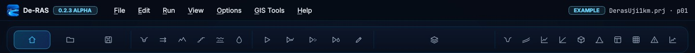

| Group | Buttons | Active now |
|---|---|---|
| PROJECT | Home, Open, Save | All three. **Home** (house icon, Ctrl+1) returns to Home from any view. **Save** (Ctrl+S) saves every changed file. |
| EDITOR | Geometry, Steady Flow, Unsteady Flow, Quasi-unsteady, Sediment, Water Quality | All of them. Unsteady Flow, Quasi-unsteady, Sediment, and Water Quality are Preview. |
| RUN | Steady Analysis, Unsteady Analysis, Sediment Analysis, Water Quality Analysis, Hydraulic Design | All of them. Everything except Steady Analysis is Preview. |
| GIS | RAS Mapper | Active (Preview). |
| RESULTS & TABLES | Cross Section, Profile, General Profile, Rating Curve, 3D Perspective, Hydrograph, Detailed Table, Profile Table, Message Summary, Time Series | All of them. Hydrograph and Time Series only hold data after an unsteady plan has been computed. |

The button of the open view is highlighted. Save and the editor buttons get a dot when they have unsaved edits. Hover over a button to see its tooltip; the tooltip of a locked button names its milestone.

## 4.4 Home and the Project Control card

Home is the first view after De-RAS opens. It holds the **Project Control** card, a summary of the open project:

| Row | Content |
|---|---|
| Project | Project title, `.prj` file path, and a button that opens the project folder |
| Plan | Active plan and its `.p##` file; the arrow opens Steady or Unsteady Flow Analysis, depending on the plan |
| Geometry | Geometry of the active plan and its `.g##` file; the arrow opens Geometric Data |
| Steady Flow | Steady flow data of the active plan and its `.f##` file; the arrow opens Steady Flow Data |
| Unsteady Flow | Unsteady flow data of the active plan and its `.u##` file; the arrow opens Unsteady Flow Data |
| Description | Project notes. The button on its right opens a larger description sheet. |
| Units badge | **SI Units** or **US Customary**, as stored in the project file |

When no project is open, the card shows **New project**, **Open project…**, and **Example project**. Below it is the **Recent projects** list: click an entry to open it, or the button at its right end to remove it from the list. The same project never appears twice in this list.

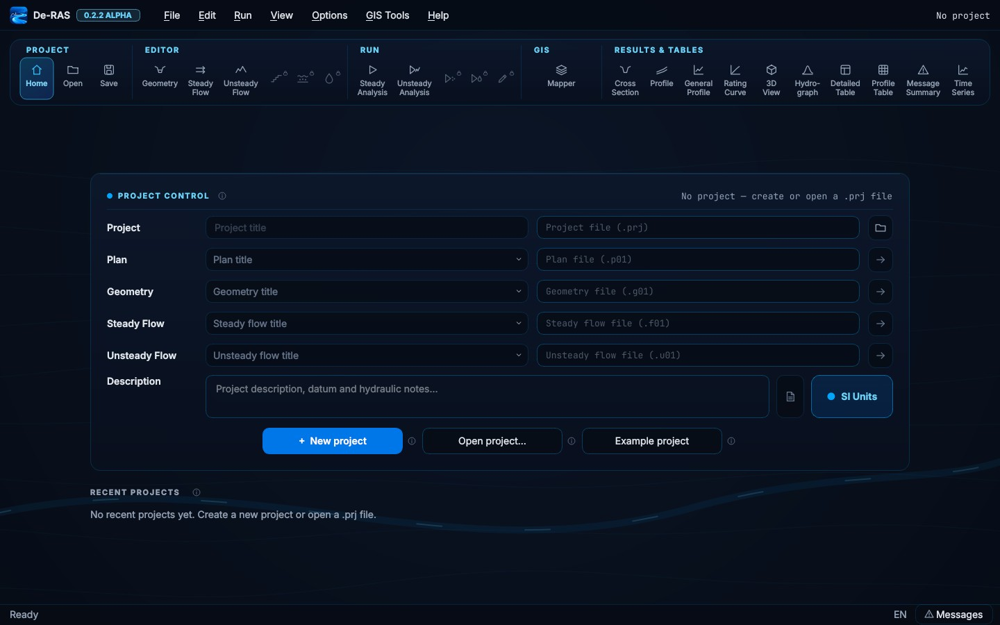

## 4.5 Moving between views

- Click a toolbar button, a menu command, or an arrow on the Project Control card, or use a shortcut (Chapter 4.9).
- Click **Back**, press **Alt+←**, or press the mouse back button to return to the previous view. **Alt+→** or the mouse forward button goes forward again. These shortcuts also work while the cursor is in an input field, a table, or a plot. While a sheet is open, close it first.
- Click **Home** (house icon) or press **Ctrl+1** to jump straight to Home.
- Unsaved edits are kept when you move between views. When you close the project or De-RAS, the **Unsaved changes** sheet offers **Save**, **Don't save**, or **Cancel**.

## 4.6 The Compute Window and the Help window

The **Compute Window** opens when you press **Compute (F5)**, or when you click the run progress in the status bar. It is a separate window and does not lock the main window, so you can keep working. Chapter 9.3 describes it.

The **Help window** can be resized and left open beside the main window while you follow its steps. It shows the help topic and links to related topics.

## 4.7 Info buttons ⓘ

Every view, card, table column, and important field has a small, muted **ⓘ** button to the right of its title. It explains:

- **What** the feature is for and when to use it.
- **How** to do it, step by step.
- **What data or files** are needed, with format, units, and example sources.
- **What you get** and common mistakes to avoid.

Hover over **ⓘ** to see a summary, or click it for a short explanation. If you need more, click **Open full help…**. Press **F1** to open help for the active view. Help is available offline in Bahasa Indonesia and English.

## 4.8 Messages drawer and status bar

The **Messages** drawer has two parts: **Log** (program and run messages) and **Model Doctor** (model check findings). It stays closed unless there is an error. Open it with the **Messages** button or the error/warning counts in the status bar, or press **Ctrl+M**. Double-click a Model Doctor finding to open the cross section it refers to. The error and warning counts in the status bar are always kept up to date while you edit.

## 4.9 Keyboard shortcuts

| Key | Action |
|---|---|
| Ctrl+N / Ctrl+O / Ctrl+S | New project / Open / Save all |
| Ctrl+1 | Home (same as the house button on the toolbar) |
| Ctrl+2 | Geometric Data |
| Ctrl+3 | Steady Flow Data |
| Ctrl+4 | Unsteady Flow Data |
| Ctrl+5 | Steady Flow Analysis |
| Ctrl+6 | RAS Mapper |
| Ctrl+7 | Results |
| Ctrl+, | Options |
| Ctrl+M | Open or close the Messages drawer |
| Alt+← / Alt+→ | Back / Forward between views (also the mouse back/forward buttons) |
| F5 | Compute the active plan |
| F7 | Model Doctor |
| F1 | Help for the active view |
| PgUp / PgDn | Upstream / downstream cross section in the Cross-Section Editor |
| Esc | Close a sheet, cancel reach or cut-line drawing, or close the Compute Window |

## 4.10 Theme, language, and options

Open **Options** with Ctrl+, or from the **Options** menu.

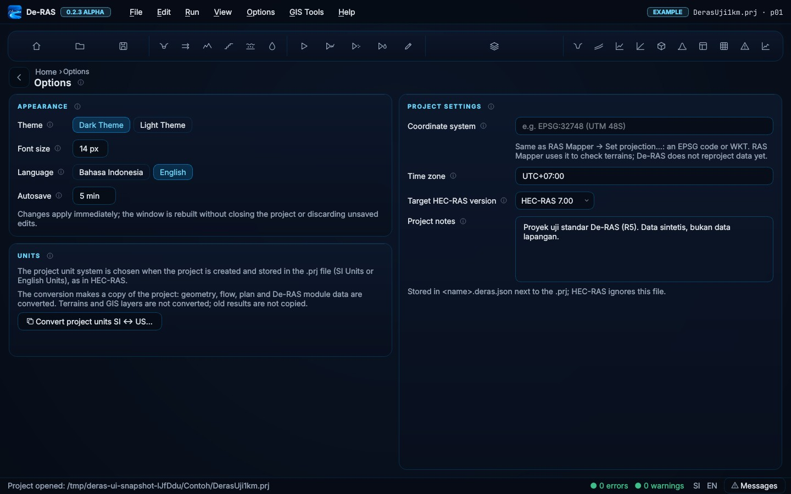

- **Appearance**: **Dark Theme** (the default, dark blue) or **Light Theme** (light blue); font size; and language (**English**, the default, or **Bahasa Indonesia**). Changes apply immediately without closing the project or discarding edits. The theme can also be changed from the **View** menu. While a run is in progress, a new theme applies after the run finishes.
- **Autosave**: the interval for recovery copies, in minutes. The default is 5; 0 turns autosave off. How it works is in Chapter 17.
- **Units**: the project units are chosen when the project is created and stored in the `.prj` file, as in HEC-RAS. The **Convert project units SI ↔ US…** button makes a copy of the project in the other unit system (Preview, Chapter 17).
- **Project settings**: coordinate system (EPSG code; the map projection is set in RAS Mapper, Chapter 6.1), time zone (recorded, not yet used by the computation), target HEC-RAS version (currently HEC-RAS 7.00), and project notes. These settings are stored in `<project>.deras.json`.

## 4.11 Differences from 0.1.0

| In 0.1.0 (old UI) | From 0.2.0 (new UI) |
|---|---|
| Project Hub | Home with the Project Control card and Recent projects |
| Ribbon: Project, Geometry, Flow, Simulation, Results, Map, Tools, Help | Menu bar and grouped toolbar |
| Model Tree and Properties panel | Project Control card; Selected object card in Geometric Data |
| Geometry, Steady flow, Plan, Results, Map (schematic) tabs under the ribbon | Geometric Data, Steady Flow Data, Steady Flow Analysis, Results views |
| Four-step new-project wizard | A single **New project** sheet |
| Messages panel and Run Manager | Messages drawer and Compute Window |
| Simulation › Run (F5) | Steady Flow Analysis › Compute (F5) |

# 5. Creating and opening a project

## 5.1 New project

1. On Home click **New project** (or **File › New project…**, Ctrl+N). The **New project** sheet opens inside the window, in three parts.
2. **1 · Name and location**: enter the **project title**, for example `River X Flood Study`, a **file name** without spaces, for example `RiverX` (De-RAS creates `RiverX.prj`), and the project **folder**. Use a short path on a local drive and avoid cloud-synchronised folders while computations run.
3. **2 · Units, coordinates, time zone**: choose **SI (metres, m³/s)** or **US Customary (feet, cfs)**. Units cannot be mixed in one project. Enter the **coordinate system** (EPSG code, optional) and the **time zone** (default UTC+07:00). The coordinate system can also be set later in RAS Mapper. The time zone is recorded but not yet used by the unsteady computation.
4. **3 · River, reach and template**: enter the first **river** and **reach** names (at most 16 characters, a HEC-RAS format limit), then choose the **Empty** or **Prismatic channel** template. The prismatic channel template builds cross sections from the bottom width, side slope, bank height, bed slope, number and spacing of cross sections, and Manning's n, so the project is ready to compute.
5. Click **Create project**. De-RAS creates `.prj`, `.g01`, `.f01`, and `.p01`, then opens the project straight away. De-RAS never overwrites an existing project.

## 5.2 Opening an existing HEC-RAS project

1. Click **Open project…** on Home, **PROJECT › Open**, or press Ctrl+O.
2. Choose the `.prj` file. De-RAS reads every plan, geometry, and flow file it lists.
3. There is no conversion: De-RAS works directly on the same files. Opening and viewing a project changes no file, and files you do not change are not rewritten.

> NOTE: De-RAS stores its own settings (coordinate system, time zone, notes) in a separate file `<project>.deras.json`. HEC-RAS ignores this file, so the project stays clean for HEC-RAS users.

## 5.3 Example project

**Example project** opens **Sungai Uji 1 km** (`DerasUji1km.prj`), the De-RAS standard test project. Its data is synthetic, not field data, and it is always labelled **EXAMPLE**. The same project is used to test every De-RAS analysis in every build, so results can be compared between versions. Since 0.2.3 it also contains examples of a 2D area, sediment, and water quality.

| Data | Value |
|---|---|
| River / reach | Sungai Uji / Utama, 1 km long |
| Cross sections | 6 cross sections every 200 m, RS 1000 (upstream) to RS 0 (downstream) |
| Cross-section shape | Trapezoidal channel with a 14 m bottom width, 1:1 side slopes, 3 m deep (20 m top width); 30 m overbanks on the left and right rising 1.5 m to the outer edge |
| Bed slope | 0.001 |
| Manning's n | Channel 0.035; overbanks 0.060 |
| Flows | Q20, Q60, Q150 = 20, 60, and 150 m³/s |
| Boundary conditions | Normal depth with slope 0.001 upstream and downstream |
| Plans | p01 "Plan steady subkritis" (short ID `Uji1km`) and p02 "Plan unsteady banjir uji" (short ID `Banjir24j`). The active plan on opening is p01. |
| Terrain | `Terrain/DerasUji1km_terrain.tif`, a 1 m GeoTIFF without an EPSG code, built from the same geometry |
| Unsteady flow | u01 "Banjir uji 24 jam": initial flow 20 m³/s; hourly hydrograph rising from 20 to 150 m³/s at hour 6, then falling to 20 m³/s at hour 18; downstream normal depth 0.001 |
| p02 simulation window | 01JAN2024 0000 to 02JAN2024 0000, computation interval 1MIN, output 30MIN |
| 2D area (0.2.3) | Geometry g02 "Geometri uji + dataran 2D": the same reach plus a 2D area **Dataran Kanan** on the right side of the river and a lateral structure at RS 790 (a 100 m side weir on the right levee). Flow u02 "Banjir uji 24 jam + dataran 2D" and plan p03 "Plan unsteady banjir + dataran 2D" (short ID `Dataran2D`), with the same simulation window as p02. |
| Sediment (0.2.3) | In g01: 22 days of quasi-unsteady data, sandy gravel with d50 2 mm, clear-water inflow. Use **Quasi-unsteady Flow Data**, **Sediment Data**, and **Sediment Analysis** (Chapter 14). |
| Water quality (0.2.3) | A 100 mg/L tracer for 3 hours upstream, with the hydraulics of the p02 flood (Chapter 15). |

The first time it is opened, the project is copied to `Documents\De-RAS Projects\Contoh\`. An existing copy is never overwritten, so your edits there stay safe. Use it to try the workflow, not as the basis of a study.

Since 0.2.3 that copy records its version in a `versi-contoh.txt` file. If your copy is older than the program, opening **Example project** offers **Open the old one** or **Update**. To install the new example at any time, use **File › Restore example project…**. The old copy is not deleted: its folder is moved to `Contoh-lama-<date time>` next to it, and the new example is installed. Your edits stay in the old copy.

> CAUTION: Example copies from build 0.2.2 or earlier do not have g02, u02, p03, sediment data, or water quality data. Use **File › Restore example project…** so you can follow the examples in Chapters 13 to 15.

## 5.4 Files in a project

A project is a set of files sharing one base name. The most important:

| File | Content |
|---|---|
| `RiverX.prj` | Project: title, units, file list, active plan. |
| `RiverX.g01` | Geometry 01: rivers, cross sections, structures, 2D areas. |
| `RiverX.f01` | Steady flow data 01: profiles, discharges, boundary conditions. |
| `RiverX.u01` | Unsteady flow data 01: hydrographs and boundary conditions. |
| `RiverX.p01` | Plan 01: geometry and flow file to run, plus computation options. |
| `RiverX.p01.deras-results.json` | Results of plan 01 as read by De-RAS. |
| `RiverX.p01.hdf` | Results of steady plan 01 in the HEC-RAS layout (HDF5, Preview, since 0.2.2). Not written for unsteady plans yet. |
| `RiverX.p01.deras-2d.bin` | 2D area results of unsteady plan 01: depth, velocity, and arrival time per cell (0.2.3, Preview). Read by RAS Mapper. |
| `RiverX.deras-sedimen.json` | Sediment Analysis results (0.2.3, Preview). |
| `RiverX.p01.deras-wq.json` | Water Quality Analysis results for plan 01 (0.2.3, Preview). |
| `RiverX.deras.json` | De-RAS settings and data that have no place in HEC-RAS files: coordinate system, terrain and background-picture lists, gate openings for steady runs, pump stations, breach data, sediment and water quality data, and calibration observations. |
| `Terrain\*.tif` | GeoTIFF terrain used by RAS Mapper. |

Appendix A lists every file type.

# 6. RAS Mapper: projection, terrain, and maps (Preview)

RAS Mapper is the De-RAS map view. Here you set the project projection, add terrain and background pictures, see reach centrelines and cross-section cut lines, cut cross sections from the terrain, make inundation maps, and (since 0.2.3) show 2D area result maps. Open it with **GIS › RAS Mapper** or **Ctrl+6**. The view title carries the **Preview — not validated** badge because its results have not been compared with HEC-RAS RAS Mapper.

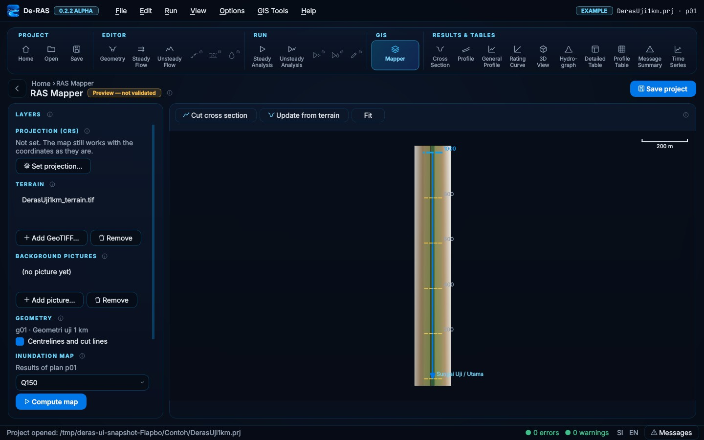

| Part | Content |
|---|---|
| **Layers** panel (left) | The **Projection (CRS)**, **Terrain**, **Background pictures**, **Geometry**, **Inundation map**, **2D area results**, and **Export** cards. |
| Tool bar (above the map) | **Cut cross section**, **Update from terrain**, and **Fit**. |
| Map (centre) | Drag to pan, mouse wheel to zoom, Home or **Fit** to show everything. Click a cut line to select its cross section. A distance scale is at the top right. |
| View bar | **Save project** on the right. |

The terrain list, background pictures, and projection are stored in `<project>.deras.json`. These settings do not change any HEC-RAS file.

## 6.1 Map projection

1. On the **Projection (CRS)** card click **Set projection…**.
2. Type an EPSG code, for example `32749` for WGS 84 / UTM zone 49S. You can also click **From .prj file…** to take the WKT text from an ESRI `.prj` file, or **From terrain** to use the projection of a loaded GeoTIFF.
3. Click **Apply**, then **Save project**.

Without a projection the map still works with the coordinates as they are. De-RAS **cannot reproject** data yet, so the terrain, background pictures, centrelines, and cut lines must already share one coordinate system. If the terrain EPSG code differs from the project projection, De-RAS shows a warning.

## 6.2 Terrain

1. On the **Terrain** card click **Add GeoTIFF…** and choose a `.tif` file.
2. A file outside the project folder is copied to the project's `Terrain` folder.
3. Click **Save project** so the terrain is recorded.

De-RAS reads single-band GeoTIFF, uncompressed or with LZW or Deflate, in strips or tiles. BigTIFF and rotated rasters are not supported yet. The reader is De-RAS's own code, without GDAL. HEC-RAS RAS Mapper terrain `.hdf` files cannot be read directly yet, but their source GeoTIFF in the same folder is loaded. Where terrains overlap, the one highest in the list wins. To take a terrain off the list, select it and click **Remove**, then **Detach**; the file itself is not deleted.

> TIP: Merge DEMs and align their vertical datum in QGIS before loading them, then check a few points of known elevation, such as a bridge deck or a benchmark.

## 6.3 Background pictures

Click **Add picture…** on the **Background pictures** card to place an aerial photo or map (PNG, JPG, or BMP). The picture needs a **world file** in the same folder, for example `photo.pgw` for `photo.png` or `photo.jgw` for `photo.jpg`, so that it lands in the right place. Rotated pictures are not supported yet. Pictures are not copied; De-RAS only records where they are.

## 6.4 Geometry on the map

The **Geometry** card shows the geometry file of the active plan. Tick **Centrelines and cut lines** to show reach centrelines (blue, with an arrow pointing downstream) and cross-section cut lines (yellow). Cut lines stored in the file (`XS GIS Cut Line`) are drawn solid. A cross section without a cut line is drawn dashed, perpendicular to the centreline, spaced by the main-channel reach length.

## 6.5 Cutting cross sections from terrain

1. Click **Cut cross section**.
2. Click points from the left bank to the right bank (looking downstream) so that the line crosses the reach centreline. Double-click or press Enter to finish, Esc to cancel.
3. The new cross-section sheet opens. Check the proposed **RS** and the **Sample spacing (m)** (the default is the terrain cell size), then click **Create section**.
4. Open the new section in the Cross-Section Editor. Check the bank stations, Manning's n, and coefficients copied from the neighbouring section, then save the geometry.

To refresh an existing cross section, click its cut line on the map and then **Update from terrain**. The ground points are sampled again from the terrain; other data stays the same.

Collinear points are dropped until at most 500 points remain. The reach length of the section upstream is split according to the position of the new line. A line drawn from right to left is reversed automatically.

## 6.6 2D area result maps (Preview)

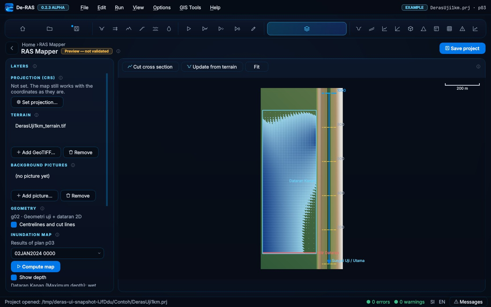

After an unsteady plan with a 2D area has been computed (F5), the **2D area results** card can be used:

1. Choose the **2D area** (if there is more than one) and a variable in the second list: **Maximum depth**, **Depth at time**, **Maximum velocity**, or **Arrival time (hours)**.
2. For **Depth at time**, drag the 2D output time slider.
3. Click **Show 2D results**. The result appears over the terrain, with the values stated on the card.
4. The map being shown can be exported from the **Export** card (GeoTIFF or PNG), like the inundation map.

Depth is computed at every terrain pixel: the cell water surface minus the terrain elevation. Velocity and arrival time have one value per cell, so they look blocky. Arrival time is the number of hours from the start of the simulation until the depth reaches 0.03 m (0.1 ft). The results are stored in `<project>.<plan>.deras-2d.bin`. These maps have not been compared with HEC-RAS RAS Mapper. Animation and result maps from a polygon mesh do not exist yet.

# 7. Building 1D geometry

Open **EDITOR › Geometry** (Ctrl+2), or the arrow on the Geometry row of the Project Control card.

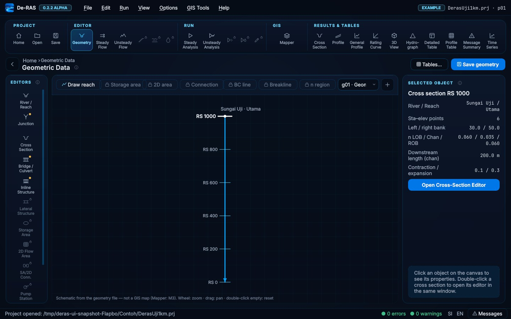

| Part of the view | Purpose |
|---|---|
| Editor palette (left) | River/Reach, Junction, Cross Section, Bridge/Culvert, Inline Structure, Lateral Structure, Storage Area, 2D Area, SA/2D Connection, Pump Station, HTab Parameters, Background Picture. All of them are active since 0.2.3. HTab Parameters and Background Picture only open an explanatory sheet: the hydraulic property tables are built automatically, and background pictures are added in RAS Mapper. |
| Drawing tools (top) | **Draw reach**, **Storage area**, **2D area**, **Connection**, and **BC line**. There are no breaklines or Manning's n regions. On the right: the geometry file selector and **+** for a new geometry file. |
| Schematic canvas (centre) | Schematic of rivers, cross sections, junctions, and structures from the geometry file, not a GIS map (the map is in RAS Mapper, Chapter 6). Mouse wheel to zoom, drag to pan, double-click an empty spot to reset the view. Click an object to select it; double-click a cross section to open the Cross-Section Editor, or a structure to open its sheet. |
| Selected object (right) | Short properties of the selected object and an **Open Cross-Section Editor** button. |
| View bar | **Tables…** (reach lengths and coefficients of all cross sections) and **Save geometry**. |

## 7.1 Rivers and reaches

1. Click **Draw reach**, then click points along the centreline of the main channel **from upstream to downstream**. Double-click or press Enter to finish; Esc cancels. Enter the river and reach names (at most 16 characters).
2. Click **Manage reaches…** to add a reach without drawing, rename a reach (the name in the flow data is updated too), or delete a reach.
3. Reaches are drawn on the schematic canvas without a background map. Reaches from HEC-RAS files that have no coordinates are drawn straight using the cross-section spacing. To see reaches over the terrain and background pictures, open RAS Mapper (Chapter 6).
4. For tributaries and splits, connect the reaches with a junction (Chapter 7.3).

> CAUTION: Always draw from upstream to downstream. River stations and flow direction follow the drawing direction.

## 7.2 Cross-Section Editor

Click **Cross Section** in the palette, double-click a cross section on the canvas, or click **Open Cross-Section Editor** on the Selected object card. The Cross-Section Editor opens as a sub-view with the breadcrumb *Home › Geometric Data › Cross section RS …*.

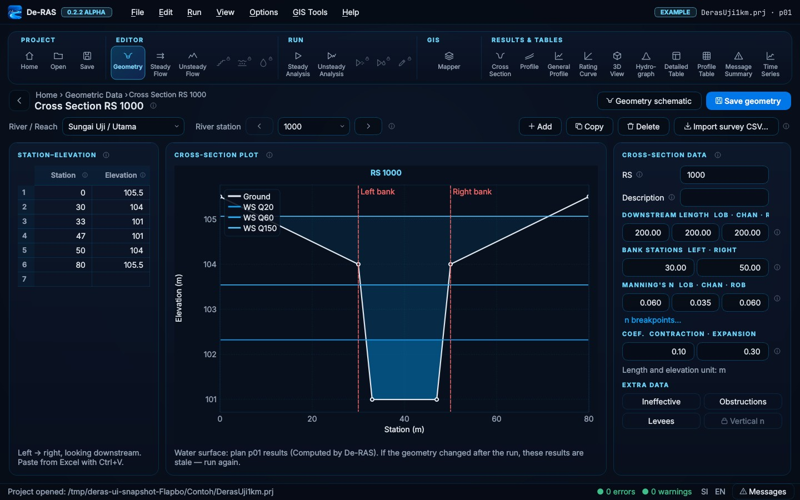

1. Choose the **River / Reach** and **River station** at the top. The **‹ ›** buttons or **PgUp/PgDn** move to the upstream/downstream cross section.
2. Fill in the **Station–elevation** table on the left: ground points from left to right looking downstream. You can paste straight from Excel with Ctrl+V.
3. Fill in the **Cross-section data** card on the right (table below).
4. Check the **Cross-section plot** in the centre. Changes in the table show immediately. After a run the plot shows the water surface of up to four profiles; if the geometry is changed after the run, the plot notes that the results are stale.
5. Click **Save geometry** to write the file, or **Geometry schematic** / **Back** to return to the schematic.

| Data | What to enter |
|---|---|
| Downstream lengths | Left overbank (LOB), channel, right overbank (ROB). A section cut in RAS Mapper gets its lengths from the position of its line. |
| Manning's n | LOB, channel, ROB. **n breakpoints…** opens a sheet for horizontal n with more segments. |
| Bank stations | Left and right limits of the main channel. |
| Contraction / expansion coefficients | Usually 0.1 / 0.3. Use 0.3 / 0.5 around bridges and culverts. |
| Extra data | The **Ineffective**, **Obstruction**, and **Levee** buttons (Preview) open a sheet to enter them; the data is computed and shown on the plot. **Vertical n** is still locked (not in 0.2.3); its data from HEC-RAS files is kept. |

**Adding, copying, deleting cross sections**: the **Add**, **Copy**, and **Delete** buttons above the plot. A new cross section is inserted in RS order (a larger RS is further upstream). **Importing a survey CSV**: click **Import survey CSV…** and choose a file with the columns `RS,Station,Elevation`; every new RS becomes a new cross section in the selected reach.

**Ineffective areas, obstructions, and levees** (Preview):

- **Ineffective**: enter the start station, end station, elevation, and **Permanent** (0 or 1) on each row. Until the water surface rises above the elevation, water in that range does not convey flow. A permanent area never conveys flow.
- **Obstruction**: enter the start station, end station, and elevation. The ground in that range is raised to that elevation.
- **Levee**: tick the left and/or right levee, then enter its station and crest elevation. Water outside the levee does not convey flow until the water surface overtops the crest.

Click **Apply** on each sheet, then save the geometry.

**Cutting cross sections from terrain**: see Chapter 6.5.

## 7.3 Junctions (Preview)

A junction connects the downstream end of the incoming reaches with the upstream end of the outgoing reaches at a confluence or split.

1. Click **Junction** in the Geometric Data palette.
2. Click **New junction**. Enter a name (at most 16 characters), then tick the reaches in the **In (from upstream)** and **Out (downstream)** columns.
3. Enter the **Length across junction** for the reaches on the side that has more than one.
4. Click **Apply**. To change or remove a junction, select it and click **Edit junction** or **Delete junction**. Structures can also be edited by double-clicking them on the canvas, or removed with **Delete structure**.

De-RAS computes junctions with the energy equation. At a split, the upstream reach takes the highest water surface of the reaches below it. Reach ends at a junction need no boundary condition. Renaming or deleting a reach updates the junction too. The momentum method is not available yet.

## 7.4 Bridges, culverts, and inline structures (Preview)

All three are computed **only for the subcritical regime** in steady flow. Model Doctor rejects an unsteady plan whose geometry contains structures. The structure blocks in the `.g##` file are written from general knowledge of the HEC-RAS format and have **not been verified** against real HEC-RAS files. A structure De-RAS cannot read is kept as-is, and Model Doctor refuses to run it.

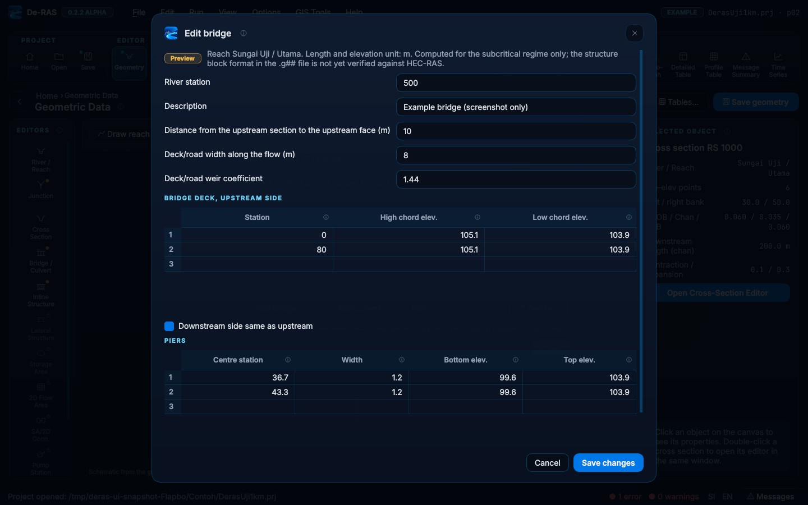

Before adding a structure, prepare four cross sections around it: one far enough upstream for the flow to be fully expanded, one just upstream, one just downstream, and one far enough downstream. Add ineffective flow areas at the sections just upstream and downstream of the structure.

**Bridge**

1. Click **Bridge/Culvert** in the palette, choose the reach, then **Add bridge…**.
2. Enter the **River station** (between the two inner sections), **Description**, **Distance from the upstream section to the upstream face**, **Deck/road width along the flow**, and **Deck/road weir coefficient**.
3. Fill in the **Bridge deck, upstream side** table: **Station**, **High chord elev.**, and **Low chord elev.** Leave **Downstream side same as upstream** ticked if the downstream deck is the same.
4. Fill in the **Piers** table: **Centre station**, **Width**, **Bottom elev.**, and **Top elev.**
5. Click **Save changes**, then save the geometry.

For low flow De-RAS computes the energy method (piers as obstructions) and Yarnell (K = 1.25) and uses the one with the higher energy. When the water reaches the deck, the sluice gate or orifice equation is used, plus weir flow over the deck. The momentum and WSPRO methods are not available yet.

**Culvert**

1. From the same palette, click **Add culvert…**.
2. Fill in the road table. For an embankment the high and low elevations are equal.
3. Under **Culvert groups (identical barrels)**, enter one row per group: shape (circular or box), span, rise, length, n, entrance and exit coefficients, **FHWA chart**, **FHWA scale**, **Upstream invert**, **Downstream invert**, and the barrel stations.
4. Click **Save changes**.

The upstream energy is the larger of inlet control (FHWA HDS-5) and full-flow outlet control. Flow over the road is computed as weir flow. Shapes other than circular and box are kept but not computed yet.

**Inline structure (weir and gates)**

1. Click **Inline Structure** in the palette, then **Add inline structure…**.
2. Enter the **Crest width along the flow**, the **Crest weir coefficient**, and the **Weir crest** table (station and **Crest elevation**).
3. Fill in **Gates**: name, width, height, **Sill elev.**, **Gate coef.**, **Opening centre stations**, and **Opening for steady runs (empty = full)**.
4. Click **Save changes**, then save the geometry.

Gate openings for steady runs are stored in `<project>.deras.json`, not yet in the HEC-RAS flow file. Multiple openings do not exist yet; their data from HEC-RAS files is kept.

## 7.5 Storage areas, lateral structures, pumps, and 2D areas (Preview)

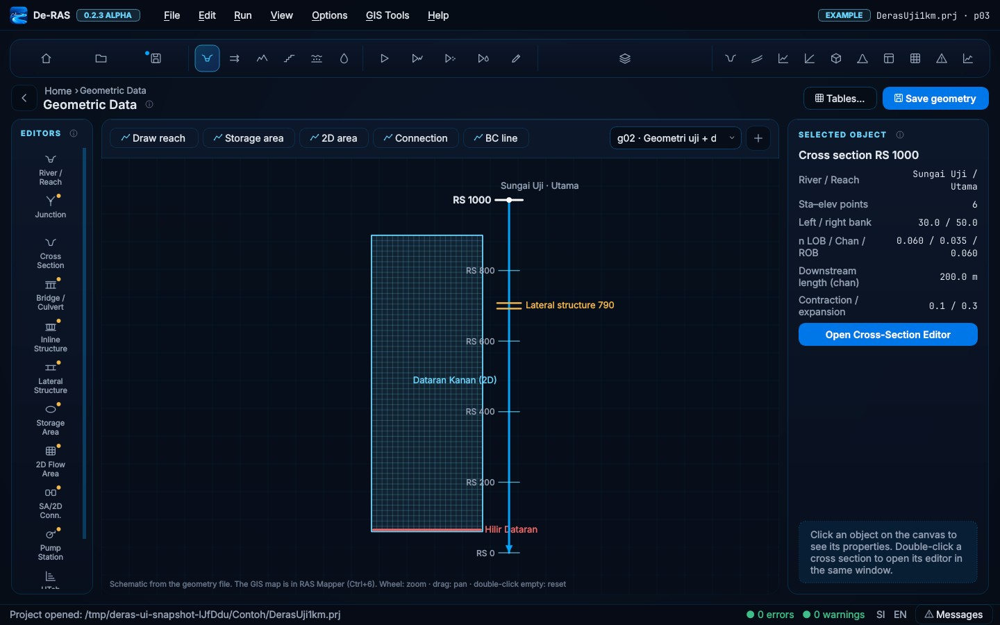

Every object in this section is computed only by **Unsteady Analysis**. Steady plans ignore them and give a warning. Each object has an input sheet with an **Add** or **Save changes** button, and the object lists can be changed with **Edit…** or **Delete…**.

**Storage area.** A pond or floodplain cell with one level water surface.

1. Click **Storage Area** in the palette, then draw its polygon on the canvas (click the points, double-click to finish), or click **Add storage area…**.
2. Enter a name (maximum 16 characters) and choose **Volume from**: **Elevation–volume table**, **Area × depth above a minimum elevation**, or **From the terrain inside the polygon** (taken at run time, needs a polygon).
3. Fill in the table, or the area and minimum elevation. Elevations must increase and volumes must not decrease.

**Lateral structure.** A weir or levee along the side of a reach that passes water to a storage area, a 2D area, or out of the system.

1. Click **Lateral Structure** in the palette, then **Add**. Enter the RS (between two cross sections), the side (left or right, looking downstream), and the distance from the upstream cross section.
2. Choose the target: out of the system, a storage area, or a 2D area.
3. Fill in the **weir crest** station–elevation table (at least two points, stations increasing) and the **weir coefficient**. The default is 1.1 for SI and 2.0 for US.
4. If the structure can fail, tick **Compute a breach in unsteady plans**. Enter the centre station, the final bottom elevation and width, the side slope, the start (hours after the simulation start), and the formation time. The **Froehlich (2008) estimate…** button proposes a width and failure time.

Flow is computed with the weir equation per crest piece, with the Villemonte submergence reduction when the downstream water level rises. Flow can reverse when the area level is higher than the river. Breach data is stored in `<project>.deras.json`, not in the plan file.

**2D area.** Click **2D Flow Area** in the palette and draw the polygon on the canvas. Enter a name, the **cell size**, and the **area Manning's n**. If the cell size is left empty, De-RAS uses about one sixtieth of the longest side. A 2D area needs a terrain in RAS Mapper. How it works and its limits are in Chapter 13.

**SA/2D connection.** A weir between two storage or 2D areas, in both directions. Click **Connection**, draw the line, choose the upstream and downstream areas (two different areas), and fill in the crest table, width, and coefficient. A breach can be entered as for a lateral structure.

**BC line.** A line along the edge of a 2D area where a boundary condition is attached. Click **BC line**, draw it near the area edge, choose the 2D area, and name it. The condition itself is set in Unsteady Flow Data (Chapter 12.1).

**Pump station.** Click **Pump Station**, then **Add**. Choose the source (a reach cross section, a storage area, or a point in a 2D area) and the target (which can also be **Out of the system**). In **Pump groups**, each group has a count (a whole number), a capacity per pump, an **On elev.**, and an **Off elev.** The off elevation must not be above the on elevation. Pumps switch on when the water level on the suction side rises above the on elevation and off below the off elevation. Pump data is stored in `<project>.deras.json`; pump blocks written by HEC-RAS are kept but not read.

## 7.6 Saving the geometry

Click **Save geometry** on the right of the view bar, or Ctrl+S. The geometry is saved to `RiverX.g01` in a format HEC-RAS can read. To create a new geometry file, click **+** next to the geometry file selector.

# 8. Steady flow data and boundary conditions

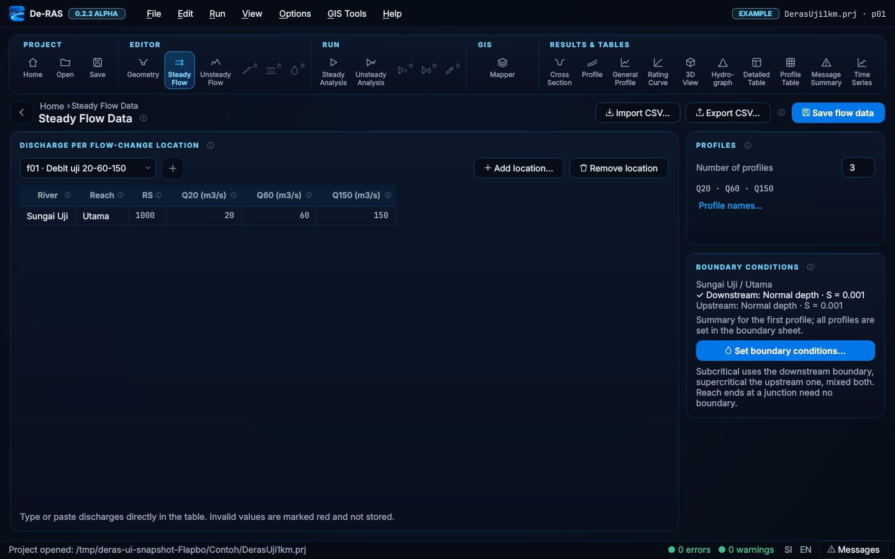

1. Click **EDITOR › Steady Flow** (Ctrl+3). Choose the flow file above the table, or click **+** to create a new steady flow file.
2. On the **Profiles** card set the **number of profiles**, then click **Profile names…** to name them, for example `Q2`, `Q5`, `Q10`, `Q25`, `Q50`, `Q100` (at most 12 characters, no commas, no duplicates).
3. In the **Discharge per flow-change location** table, enter the discharge of each profile at the most upstream cross section of every reach. Click **Add location…** where a tributary or inflow adds discharge, and **Remove location** to remove one. You can paste discharges from Excel; invalid values are marked red and are not saved. **Import CSV…** and **Export CSV…** use the header row `River,Reach,RS,<profile 1>,<profile 2>,…`.
4. On the **Boundary conditions** card click **Set boundary conditions…**. The boundary sheet opens with one row per reach and profile, with downstream columns and an **Upstream type** column. The copy button fills the selected row into every profile of that reach. Boundary types:
   - **Normal depth**: enter the energy slope, usually the bed slope near the boundary (for example `0.001`).
   - **Known W.S.**: a fixed elevation, for example sea level.
   - **Critical depth**: where flow passes through critical depth, as at a weir or drop.
   - **Rating curve** (downstream only): stage:flow pairs. Partial, because its format in the `.f##` file has not been verified with HEC-RAS.
5. The subcritical regime needs a downstream boundary, supercritical needs an upstream one, and mixed needs both. Upstream boundaries can be normal depth, known W.S., or critical depth. Reach ends at a junction need no boundary.
6. Click **Save flow data**.

> TIP: Place the downstream boundary far enough below the study area that an error in the assumed slope does not affect results where you need them. Test by changing the slope and checking that upstream results do not change.

# 9. Running a steady simulation

## 9.1 The Steady Flow Analysis view

Click **RUN › Steady Analysis** (Ctrl+5).

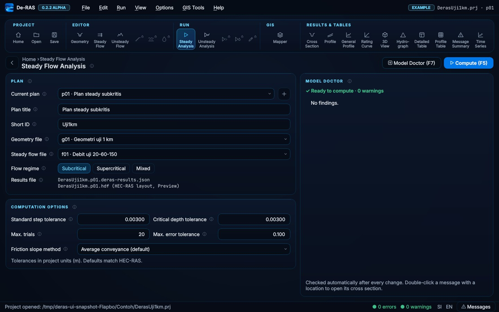

1. Choose the **Current plan**, or click **+** to create a new plan. A new plan uses the geometry and flow files currently open. Enter the **Plan title** and **Short ID**, for example `Existing`.
2. Choose the **Geometry file** and **Steady flow file**.
3. **Flow regime**: **Subcritical** (computed from downstream to upstream), **Supercritical** (from upstream to downstream), or **Mixed**. Supercritical and Mixed are Preview. In the mixed regime De-RAS computes both profiles and, at every section, keeps the one with the larger specific force, so hydraulic jumps are found and reported in the run messages. Structures (Chapter 7.4) are computed only in the subcritical regime.
4. **Results file** shows where results are written: `<project>.p01.deras-results.json` (read by De-RAS) and `<project>.p01.hdf` in the HEC-RAS results layout (Preview, never opened in HEC-RAS yet). If a `.p01.hdf` made by another program already exists, it is not overwritten; De-RAS writes `<project>.p01.deras.hdf` and shows a warning.
5. If needed, change the **Computation options**: standard step tolerance, critical depth tolerance, maximum trials, maximum error tolerance, and the **friction slope method** (default average conveyance). The defaults are the same as in HEC-RAS.

## 9.2 Checking the model with Model Doctor

The **Model Doctor** card on the right of the Steady Flow Analysis view checks the active plan whenever something changes. Press **F7** or click **Model Doctor (F7)** to see the details in the Messages drawer. Double-click a finding to open its cross section.

If you press **Compute (F5)** while the model still has errors, the **Model Doctor** pop-up appears and lists each error (up to 12):

- **What is wrong**, for example a downstream boundary condition that has not been set.
- **Where**: the plan, river/reach, or RS involved.
- **How to fix it**, with a quick-fix button where possible: **Open Steady Analysis**, **Open Steady Flow**, **Open Geometric Data**, or **Open cross section** for errors at a specific cross section.

At the bottom are **Show in Messages drawer** and **Close**. Warnings do not stop the computation, so the pop-up only gives their number; the list is in the Messages drawer.

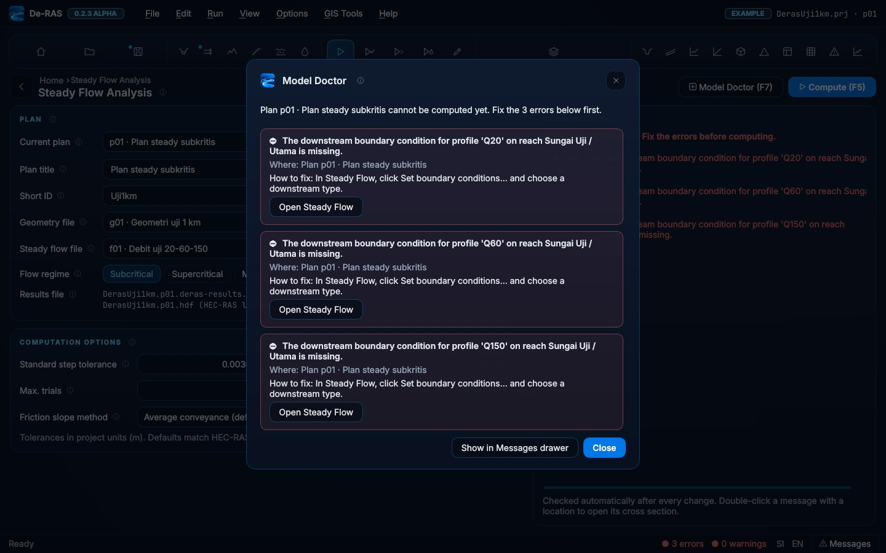

| Common finding | What to do |
|---|---|
| Cross sections too far apart | Add cross sections between them. |
| Bank station outside the ground data | Move the bank station to a ground point. |
| Manning's n outside the usual range | Check the land-cover class and the n table. |
| Stations out of order or duplicated | Fix the station–elevation table. |
| Boundary condition missing | Add the boundary condition in the flow data: downstream for subcritical, upstream for supercritical, both for mixed. |
| Unreadable structure, or a bridge/culvert/inline structure in a supercritical/mixed/unsteady plan | Bridges, culverts, and inline structures are computed only for subcritical steady flow. Change the regime, or remove the structure from that plan's geometry. Storage areas, lateral structures, pumps, and 2D areas are not affected by this rule. |
| Reach end without an unsteady boundary | Click **Add reach ends** in Unsteady Flow Data (Chapter 12). |

## 9.3 Computing and the Compute Window

1. Click **Compute (F5)** on the right of the view bar. De-RAS saves the project, then opens the **Compute Window**. If the project cannot be saved, the run is cancelled and the reason is written to the log.
2. The Compute Window shows the run **Steps**: pre-process (read and check geometry, flow, plan), steady simulation (standard step) or 1D unsteady simulation, and write results (atomic). Inundation maps are made separately in RAS Mapper (Chapter 10.3). For an unsteady plan with a 2D area, the 2D computation runs together with the 1D computation and has no step of its own. Below them are a progress bar with a percentage, the **Queue**, and a **Log** you can copy. The label at the top right shows the status: READY, RUNNING, DONE, FAILED, or CANCELLED.
3. When it finishes, read the error and warning summary in the log. Errors stop the computation; warnings must be reviewed.
4. Click **View results**. The main window switches to the Results view.

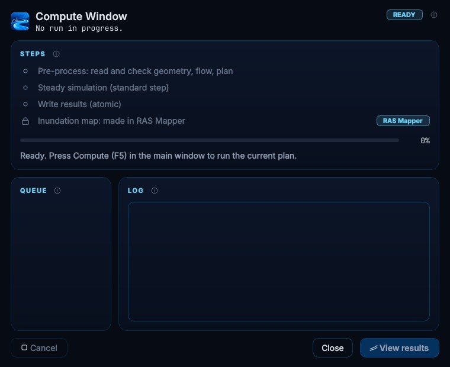

## 9.4 Queue and cancelling

- The **Queue** shows the plans waiting to be computed; they run one at a time while you keep working in the main window.
- **Cancel** stops the computation engine safely. If a run is cancelled or fails, earlier results are not changed and no new results are shown as if the run had succeeded.
- If you close the Compute Window while a run is in progress, De-RAS offers **Back**, **Cancel run**, or **Close, keep running**. If the run keeps going, its progress appears in the status bar; click it to open the Compute Window again.
- Every run records the input files, computation settings, engine version, time, warnings, and a results summary, so the run can be repeated.

# 10. Reviewing results

Every table and plot shows where its data comes from, for example **Computed by De-RAS · deras-steady 0.2.3** or **deras-unsteady 0.2.3**, or **Example** for the example project. Results from Preview features are also marked Preview. Results are shown only for runs that finished successfully. If an input file changes after a run, the results are marked **stale**.

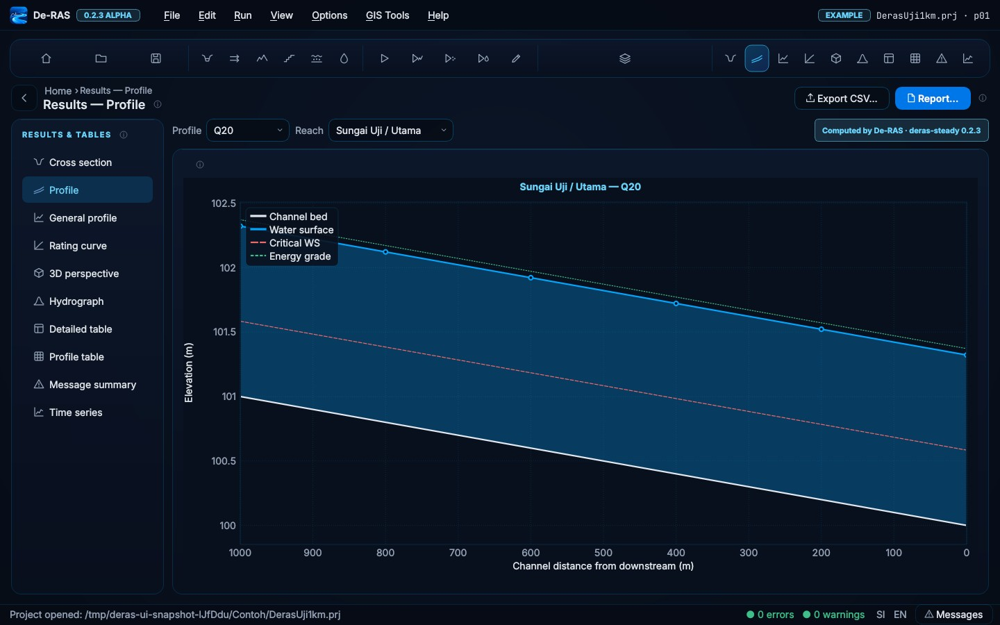

## 10.1 The Results view

Click any **RESULTS & TABLES** button (Ctrl+7). The result pages are listed on the left; the profile, reach, and RS selectors are at the top (an unsteady plan has a **Max WS** profile and one profile per output time); **Export CSV…** and **Report…** are on the right of the view bar.

| Result page | Content | Available |
|---|---|---|
| Cross section | Cross section with ground, water surface, energy grade, critical water surface, and banks | 0.1.0 |
| Profile | Channel bed, water surface, critical water surface, and energy grade along the reach | 0.1.0 |
| General profile | One result variable along the reach for every profile, for example channel velocity or Froude number | 0.2.0 |
| Rating curve | Water surface, energy grade, and critical water surface against discharge at one cross section, from every profile of the plan. Points between profiles are joined by straight lines. | 0.2.2 |
| 3D perspective | The cross sections of one reach and the water surface of one profile in three dimensions. Drag to rotate, mouse wheel for vertical scale. | 0.2.2 |
| Hydrograph | Stage (with the channel bed) and flow against time at one cross section, from an unsteady plan | 0.2.2, Preview |
| Detailed table | Every result variable of one cross section for one profile | 0.2.0 |
| Profile table | Discharge, minimum channel elevation, water surface, critical water surface, energy grade, energy slope, velocity, area, top width, and Froude number per cross section | 0.1.0 |
| Message summary | Run messages: information, warnings, and errors | 0.1.0 |
| Time series | Table of date-time, hour, stage, and flow at one cross section for every output time of an unsteady plan. Can be copied into a spreadsheet. | 0.2.2, Preview |

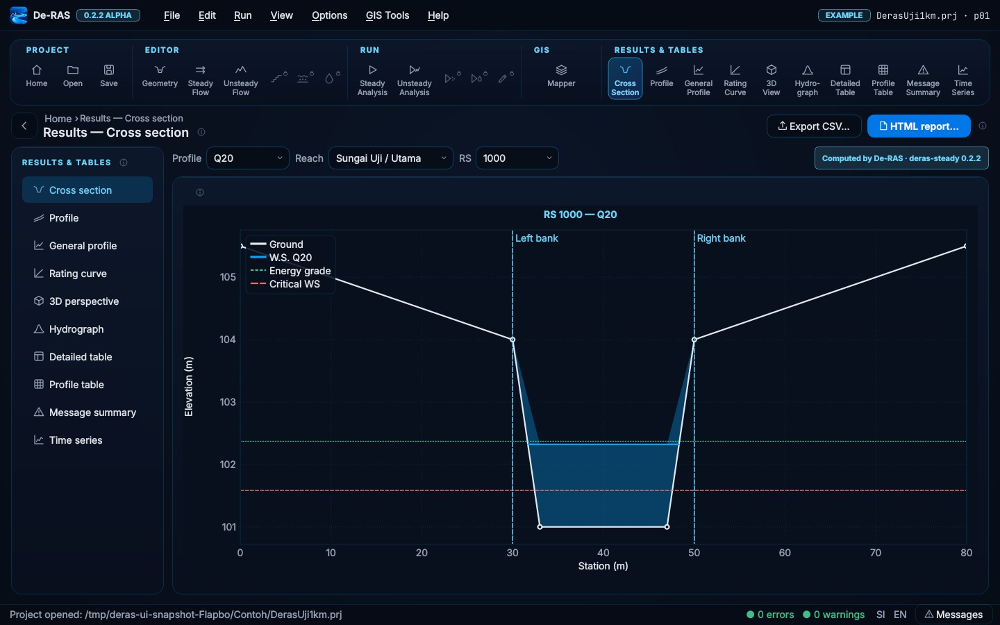

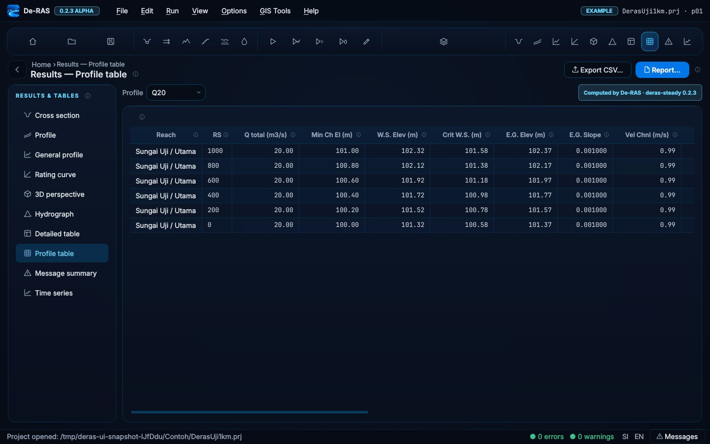

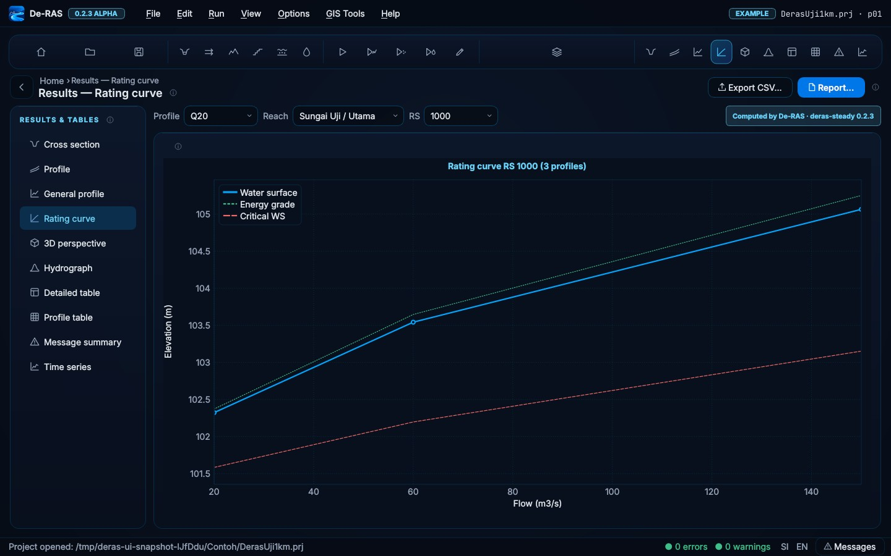

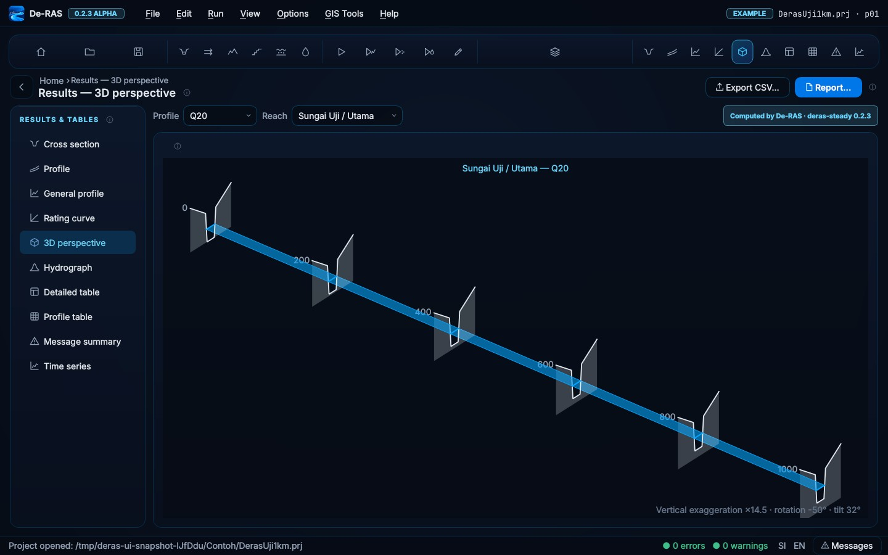

For an unsteady plan that has storage areas, lateral structures, pumps, or SA/2D connections, the reach list on the Hydrograph and Time series pages also contains those objects, for example **Lateral structure: …**. They show lateral flow hydrographs, storage-area water levels and volumes, or pump flows. 2D areas have their own maps in RAS Mapper (Chapter 6.6), and their volume error is written in the run messages.

## 10.2 Warnings on results

| Warning | Meaning and action |
|---|---|
| Critical depth assumed | No subcritical solution was found. Check the geometry and n values; add cross sections; consider the mixed regime. |
| Conveyance ratio outside 0.7–1.4 | Cross sections are too far apart or change too quickly. Add cross sections. |
| Energy loss greater than 0.3 m | A large change between cross sections. Add cross sections. |
| Divided flow | Water flows in separate parts of the section. Check whether ineffective areas or levees are needed. |
| Water surface beyond the end of the section | Extend the cross section; results there are not reliable. |

## 10.3 Inundation maps (Preview)

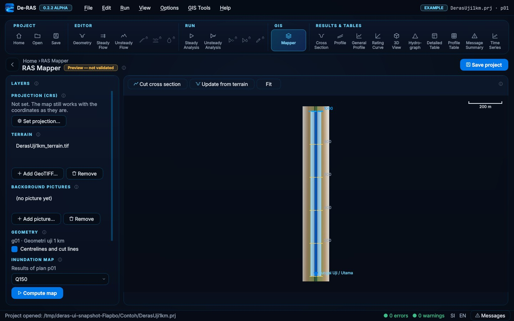

1. Compute the steady plan (F5).
2. Open RAS Mapper (Ctrl+6). On the **Inundation map** card, choose a profile, for example `Q150`.
3. Click **Compute map**. Tick **Show depth** to display the depth map. The flooded area appears below the card (for the example project, Q150 gives about 6.30 ha).
4. Check the map edges: if flooding touches the end of a cross section, that section is too short.
5. Export from the **Export** card: **Depth (GeoTIFF)…**, **Water surface (GeoTIFF)…**, or **Map image (PNG)…**. GeoTIFF files are float32 with no-data -9999 and the terrain's coordinate system, so they open in QGIS or ArcGIS.

Between two consecutive cut lines the water surface is interpolated linearly by distance to each line, then the terrain elevation is subtracted. There is no flow-connectivity check yet, so a depression separated from the river but lying between cut lines is flooded too. Velocity maps, flood-boundary polygons, and GeoPackage or KMZ export are not available yet, and neither are maps from unsteady results.

# 11. Reports and export

- **Export CSV…** (Results view): the table currently shown, with units.
- **Report…** (Results view): a run report in three formats, chosen in the save box: **HTML**, **Word (.docx)**, or **PDF**. It contains the project summary, run configuration and engine version, result tables, warnings and errors, and the status of the features used. If the plan has no results yet, the button only shows a message that there is nothing to report.
  - The Word file is written directly by De-RAS and has only been checked with LibreOffice; it has never been opened in Microsoft Word (test W6). If it looks odd in Word, use HTML or PDF and tell the developer.
  - The PDF is A4 landscape.
- **File › Duplicate project (Save As)…** copies every project file to a new name or folder, for example to archive each stage of a study. De-RAS refuses if the target file already exists.

# 12. 1D unsteady flow (Preview)

Unsteady flow uses hydrographs instead of constant discharges. Use it when channel storage or flood travel time affects the results. The example project has a ready-made unsteady plan (p02, Chapter 5.3).

Limits in 0.2.3: subcritical regime only, one flow path per reach; ineffective areas do not store water. Bridges, culverts, and inline structures are not computed in unsteady runs, and Model Doctor rejects a run whose geometry contains them. Since 0.2.3, storage areas, lateral structures, SA/2D connections, pumps, and 2D areas are computed (Preview, Chapters 7.5 and 13). Results are stored in `<project>.<plan>.deras-results.json`; an `.hdf` results file is not written for unsteady plans yet. The project time zone is not used yet; plan dates and times are taken as they are.

## 12.1 Unsteady Flow Data

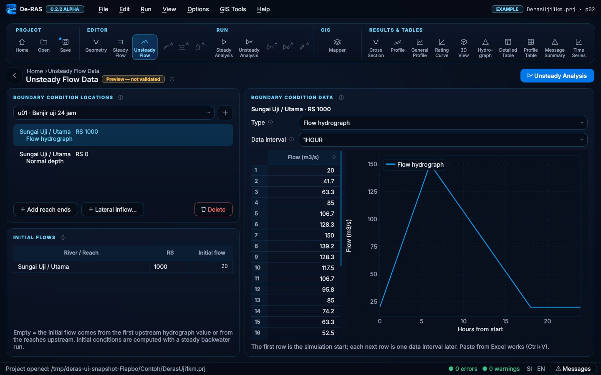

1. Click **EDITOR › Unsteady Flow** (Ctrl+4). On the **Boundary condition locations** card, choose the unsteady flow file (for example `u01 · Banjir uji 24 jam`) or click **+** for a new one.
2. Click **Add reach ends**. Every upstream reach end gets a flow hydrograph and every downstream end gets normal depth. Reach ends at a junction are skipped.
3. Select each location in the list and fill in the **Boundary condition data** card on the right:
   - **Type**: **Flow hydrograph**, **Stage hydrograph**, **Normal depth**, **Rating curve**, **Lateral inflow hydrograph**, or **Uniform lateral inflow hydrograph**. Upstream, use a flow or stage hydrograph. Downstream, use a stage hydrograph, normal depth, a rating curve, or a flow hydrograph. Other types from HEC-RAS files show as **Other (kept, not computed)**.
   - **Data interval**, for example `1HOUR`. The first table row is the simulation start; each following row adds one interval.
   - Fill in the value table, or paste from Excel (Ctrl+V). The plot beside it updates at once, with **Hours from start** on the axis.
   - For normal depth, enter the friction slope (greater than 0). For a rating curve, enter rising stage and flow pairs.
4. For inflow along a reach, click **Lateral inflow…**, choose the reach, the type (single point or uniform), and the RS, then fill in its hydrograph. **Delete** removes the selected location.
5. In the **Initial flows** table, enter the flow in each reach at the start of the simulation. If left empty, the first value of the upstream hydrograph is used. De-RAS computes a steady profile with these flows as the initial state.
6. If the geometry has storage areas or 2D areas, click **Area/BC line…** and attach their boundary conditions: flow, stage, rain, or (for a BC line on a 2D area) a flow hydrograph, a stage hydrograph, or normal depth. Also enter the initial stage of the area.
7. Save the project, then click **Unsteady Analysis** at the top right.

The format of the Rating Curve and lateral inflow lines in the `.u##` file has not been verified with HEC-RAS. Lines De-RAS does not recognise are kept as they are, and unchanged blocks are written back exactly as they were.

## 12.2 Unsteady Flow Analysis

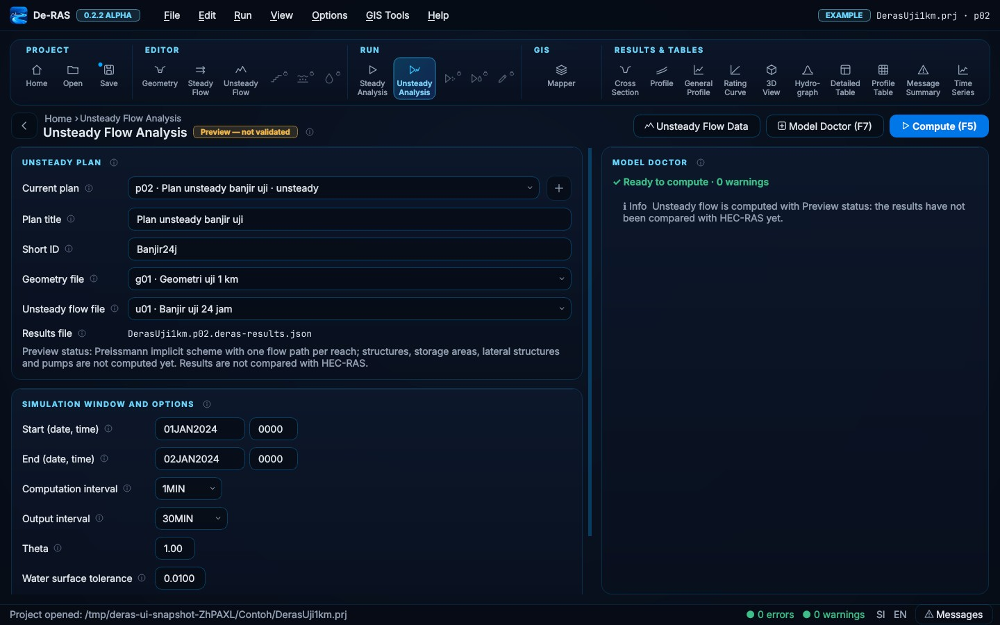

1. Click **RUN › Unsteady Analysis**. On the **Unsteady plan** card, choose the **Current plan** or click **+** for a new one. Enter the **Plan title** and **Short ID**.
2. Choose the **Geometry file** and **Unsteady flow file**. **Results file** shows the target `.deras-results.json` file.
3. On the **Simulation window and options** card, enter:
   - **Start** and **End**: date `DDMMMYYYY` (for example `01JAN2024`) and time `HHMM` (for example `0000`).
   - **Computation interval**, for example `1MIN`, and **Output interval**, for example `30MIN`. The output interval should be a multiple of the computation interval. Results are kept for at most 100 output times.
   - **Theta** (0.5 to 1.0; the default 1.00 is the most stable), **Water surface tolerance** (default 0.0100), and **Max. iterations per step** (default 20).
4. Press **Model Doctor (F7)**, then **Compute (F5)**. The Compute Window shows the **1D unsteady simulation** step.

The engine uses the four-point implicit Preissmann scheme on the Saint-Venant equations, with Newton iterations in every step. Junctions use equal water surfaces and flow continuity. Flow through lateral structures, connections, and pumps is computed implicitly in the same step as the river flow, and a 2D area uses the plan's computation interval as its time step. The run messages state the volume error of each area. For the example project, p02 finishes in 1,440 steps, with a downstream peak of 146.2 m³/s about 0.5 hours after the upstream peak. Plan p03 (Chapter 5.3) uses the same hydrograph and passes part of the flood over a 100 m side weir into the 2D area Dataran Kanan; the volume error of that area is below 1 percent.

## 12.3 Hydrographs and time series

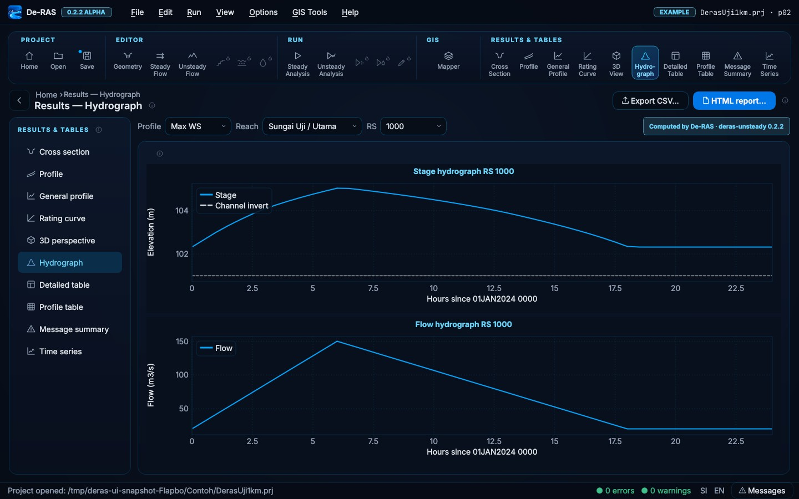

Open **RESULTS & TABLES › Hydrograph** for plots of stage and flow against time at one cross section, or **Time series** for the table. Choose the reach and RS at the top. The Cross section, Profile, and Profile table pages also work for unsteady plans, with the **Max WS** profile or a profile for a given time.

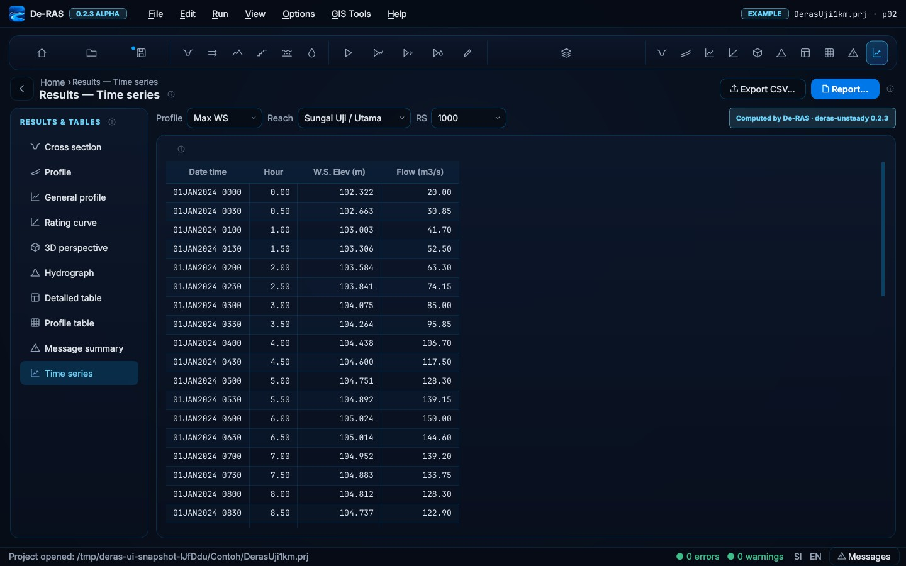

> TIP: If the computation is unstable or often reaches the iteration limit (logged as a warning), reduce the computation interval, add cross sections where the geometry changes sharply, or raise theta to 1.0.

# 13. 2D flow areas (Preview)

A 2D area computes flow over a floodplain that cross sections describe poorly, for example water spreading behind a levee. The example project has plan p03, which uses one.

**What is built in 0.2.3 is simpler than a HEC-RAS 2D area.** The area is divided into square grid cells, not a polygon mesh. The equation is the diffusion wave, solved fully implicitly (Picard iteration with conjugate gradients). Every cell stores terrain samples, so the cell volume and the face conveyance follow the terrain inside the cell, but this is not the same mesh and subgrid as in HEC-RAS. The results have not been compared with HEC-RAS.

## 13.1 Setting up a 2D area

1. Make sure a terrain has been added in RAS Mapper (Chapter 6.2). A 2D area cannot be computed without terrain.
2. In Geometric Data click **2D Flow Area** in the palette and draw the area boundary on the canvas. Enter a name, the **cell size**, and the **area Manning's n**. An empty cell size means automatic, about one sixtieth of the longest side. Smaller cells give more detail and a longer computation.
3. Connect the area to the river with a **Lateral Structure** (target: 2D area) or an **SA/2D Connection**, and attach inflow or outflow with a **BC line** along the area edge (Chapter 7.5).
4. In Unsteady Flow Data click **Area/BC line…** and fill in the BC line conditions and the initial stage of the area. Rain can be attached as a boundary condition of the area.
5. Create an unsteady plan that uses that geometry and flow file (Chapter 12.2), run **Model Doctor (F7)**, then press **Compute (F5)**.

## 13.2 Reviewing results

Look at 2D results in RAS Mapper, on the **2D area results** card (Chapter 6.6): maximum depth, depth at a chosen time, maximum velocity, and arrival time. The run messages state the volume error of each area. The volume error shows how well inflow, outflow, and storage add up; for p03 it is below 1 percent. A large error points to a problem in the data, not only in the computation.

## 13.3 Limits

- Diffusion wave only. The Shallow Water equations are not available, so inertia terms, hydraulic jumps, and supercritical flow in a 2D area are not represented.
- Square grid only. Polygon meshes, breaklines, and refinement regions do not exist yet.
- A fixed time step equal to the plan's computation interval. An adaptive time step based on the Courant number does not exist yet.
- No animation of 2D results, no infiltration, and no Manning's n regions. One Manning's n applies to the whole area.
- 2D results are not written to `.p##.hdf`, and the `.g##.hdf` file for 2D meshes does not exist.

# 14. Sediment transport (Preview)

The sediment module computes bed change over time with the Exner equation. Its hydraulics come from a quasi-unsteady flow series: the discharge is divided into time blocks, and the hydraulics of each block are computed as steady flow. The example project has sediment data in geometry g01.

**Limits.** One reach, one grain size (d50), and no armouring or grain sorting. The results have not been compared with HEC-RAS. HEC-RAS `.q##` and `.s##` files are not read or written; the data is stored in `<project>.deras.json`.

## 14.1 Quasi-unsteady Flow Data

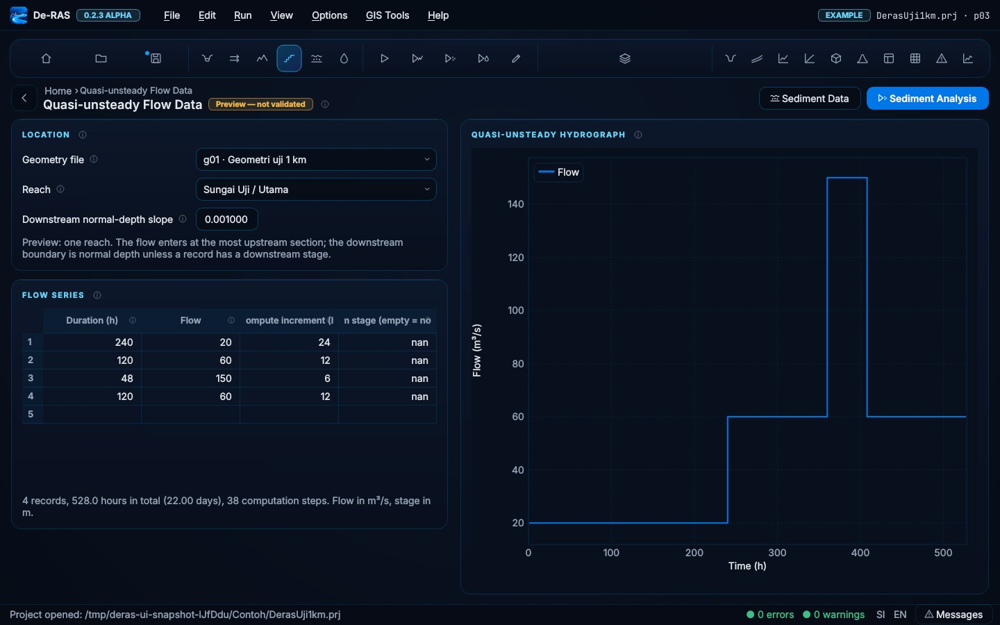

1. Click **EDITOR › Quasi-unsteady**. On the **Location** card choose the **Geometry file** and the **Reach**, then enter the **Downstream normal-depth slope**.
2. In **Flow series**, enter the **Duration (h)** and **Flow** of each block. The table can be pasted from Excel. The plot on the right shows the hydrograph.
3. Enter the **Compute increment (h)**. If the **Downstream stage** is left empty, the downstream boundary uses normal depth.

## 14.2 Sediment Data

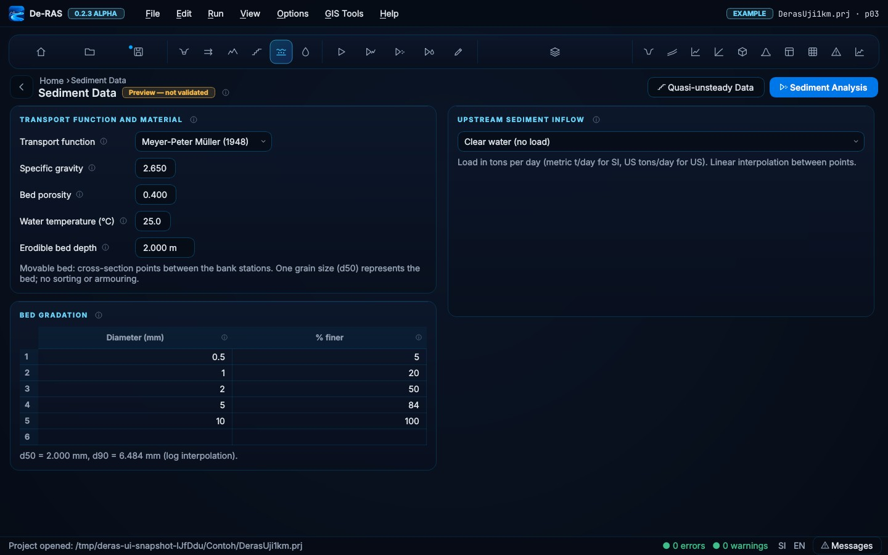

1. Click **EDITOR › Sediment**. Choose the **Transport function**: Meyer-Peter and Müller (MPM), Engelund–Hansen, or Yang. Enter the **Specific gravity** (default 2.65), **Bed porosity** (default 0.4), **Water temperature**, and **Erodible bed depth**.
2. In **Bed gradation**, enter pairs of **Diameter (mm)** and **% finer**. De-RAS computes d50 and d90 by logarithmic interpolation and shows them.
3. Under **Upstream sediment inflow**, choose **Equilibrium load** (equal to the transport capacity), **Clear water** (no load), or a **Flow–load rating curve** (enter flow and load pairs).

> NOTE: Each transport function has its own range of validity. Check that the grain size, slope, and depth of your project are inside that range before trusting the results.

## 14.3 Sediment Analysis

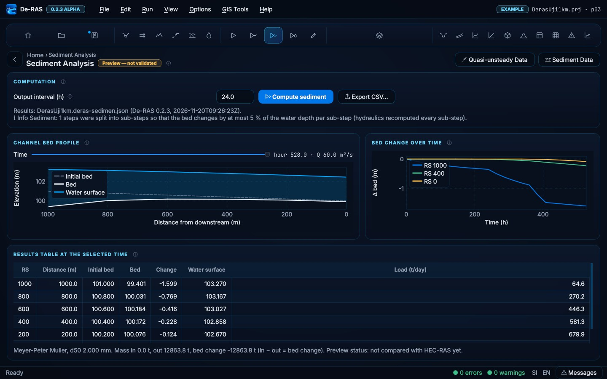

1. Click **RUN › Sediment Analysis**. The **Computation** card shows the **Output interval (h)**. The time step is split automatically when the depth changes by more than 5 percent in one step.
2. Click **Compute sediment**. If the data is incomplete, a message names what is missing.
3. Drag the time to see the **Channel bed profile** (initial bed, bed, and water surface), the **Bed change over time**, and the **Results table at the selected time** (including loads).
4. **Export CSV…** writes every time. The results are stored in `<project>.deras-sedimen.json`.

> NOTE: Sediment results depend strongly on the transport function and the gradation data. Calibrate against field data before drawing conclusions.

# 15. Water quality (Preview)

The water quality module computes the spread of one dissolved substance along the reach over time. Its hydraulics (water level and flow at every output time) are taken from the results of the unsteady plan you choose, in the first reach of that plan, so the unsteady plan must already have been computed.

**Limits.** One substance in mg/L, with first-order decay. Temperature, dissolved oxygen (DO), nutrients, and reactions between substances are not available. HEC-RAS `.w##` files are not read or written; the data is in `<project>.deras.json`.

## 15.1 Water Quality Data

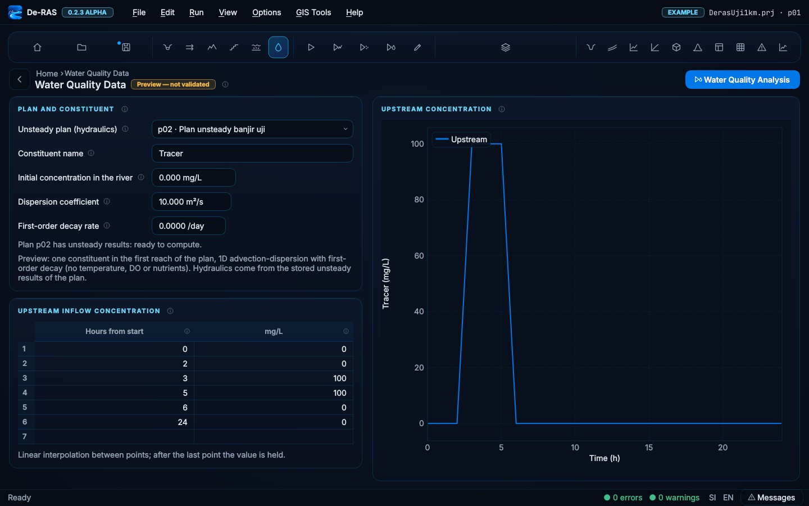

1. Click **EDITOR › Water Quality**. In **Plan and constituent**, choose the **Unsteady plan (hydraulics)**. The card says whether that plan already has results.
2. Enter the **Constituent name**, **Initial concentration in the river**, **Dispersion coefficient**, and **First-order decay rate** (per day; 0 means a conservative substance).
3. Under **Upstream inflow concentration**, fill in the table of **Hours from start** and concentration. Between points De-RAS interpolates linearly, and after the last point the value is held.

## 15.2 Water Quality Analysis

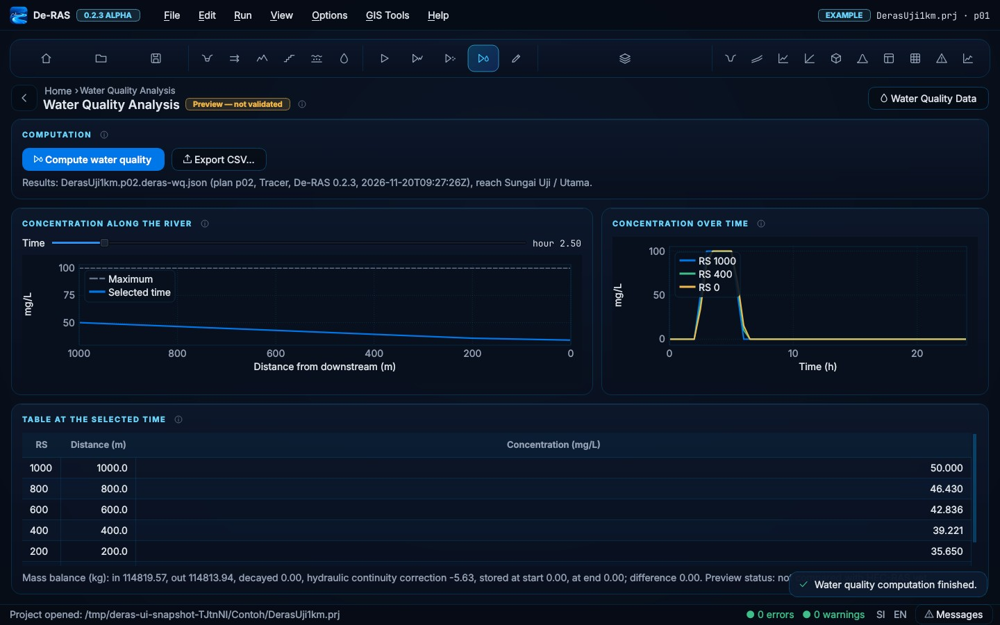

1. Click **RUN › Water Quality Analysis**, then **Compute water quality**.
2. Drag the time to see the **Concentration along the river**. The **Concentration over time** plot shows upstream, middle, and downstream. The **Table at the selected time** gives the values.
3. **Export CSV…** writes every time. The results are stored in `<project>.<plan>.deras-wq.json`.

The equation is 1D advection–dispersion with an implicit finite volume scheme (upwind advection, central dispersion). The time step is split so that the Courant number is about 1. The mass balance is written with the results: change in storage equals inflow minus outflow minus decay, plus a hydraulic continuity correction. The correction exists because the hydraulics stored at each output time do not close continuity exactly. In the example of a 100 mg/L tracer for 3 hours on p02, the correction is 5.6 kg out of 114.8 tonnes of inflow mass. If the correction is large, shorten the output interval of the unsteady plan.

# 16. Hydraulic design and calibration (Preview)

Click **RUN › Hydraulic Design**. The view has three tabs: **Uniform flow**, **Scour (HEC-18)**, and **Manning's n calibration**. All three are Preview: their formulas and results have not been compared with HEC-RAS. Design decisions remain the designer's responsibility.

## 16.1 Uniform flow

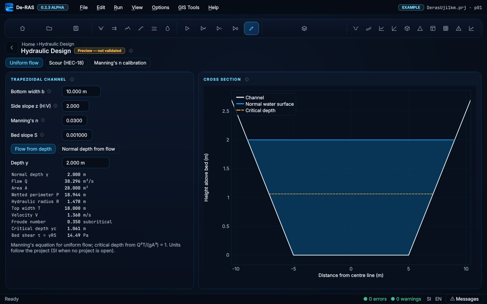

This computes discharge from depth, or normal depth from discharge, in a trapezoidal channel with Manning's equation. Units follow the open project.

1. Enter the **Bottom width b**, **Side slope z (H:V)** (0 means a rectangular channel), **Manning's n**, and **Bed slope S**.
2. Choose **Flow from depth** or **Normal depth from flow**, then enter the **Depth y** or the **Flow Q**.
3. The results and the section drawing update at once: area, wetted perimeter, hydraulic radius, top width, velocity, Froude number (with a subcritical, near critical, or supercritical note), critical depth, and bed shear.

Normal depth is found by bisection. If the input makes a result impossible (for example a zero bottom width or slope), a message says it cannot be computed.

## 16.2 Bridge scour (HEC-18)

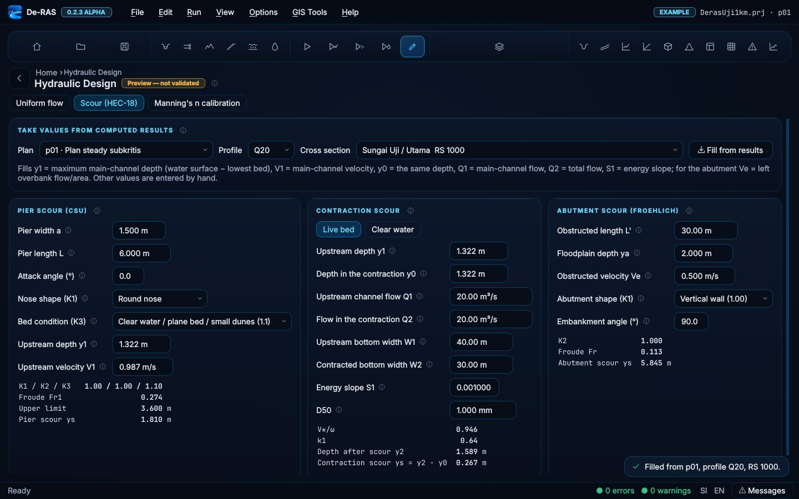

This computes scour after FHWA HEC-18, 5th edition (2012):

- **Pier scour (CSU)**: choose the **Nose shape (K1)** and **Bed condition (K3)**, and enter the pier width and length, the **Attack angle**, and the upstream depth and velocity. For round-nosed piers aligned with the flow, the result is limited by the HEC-18 upper limit (2.4 times the width for Fr ≤ 0.8; 3.0 times above that).
- **Contraction scour**: **Live bed** (modified Laursen 1960) or **Clear water** (Laursen 1963, with the bed D50). Enter the depths, flows, upstream and contracted bottom widths, and the energy slope. Scour = y2 − y0; if y2 < y0 there is no contraction scour.
- **Abutment scour (Froehlich)**: choose the abutment shape (vertical wall, wing wall, or spill-through), and enter the obstructed length, the floodplain depth, the obstructed velocity, and the embankment angle. If L'/ya is above 25, HEC-18 recommends the HIRE equation, which De-RAS does not have.

To fill in data from computed results, choose the plan, profile, and cross section under **Take values from computed results**, then click **Fill from results**. De-RAS fills in main-channel depth and velocity, flows, the energy slope, and the overbank velocity as a starting point; check them against the real bridge. The scour of each card is shown below it, and the total at the piers is at the bottom. A note appears when L/a is above 12 (K2 is computed with 12) or when the upper limit is used.

## 16.3 Manning's n calibration

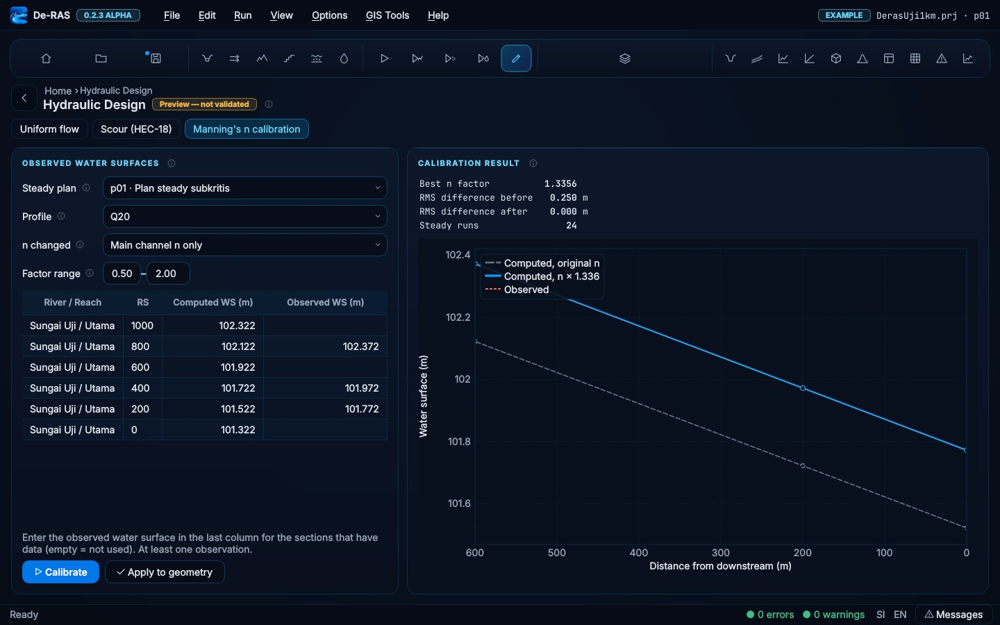

De-RAS looks for **one multiplying factor for Manning's n** so that the computed steady water surface comes closest to the observed water levels.

1. Choose the **Steady plan** and the profile that matches the observed event.
2. In the **Observed water surfaces** table, enter the observed water level in the last column at the cross sections that have observations.
3. Choose **Main channel n only** or **All n (channel and overbanks)**, and set the search **Factor range**.
4. Click **Calibrate**. De-RAS runs repeated steady computations (a golden-section search) and minimises the RMS of the water level difference. Check the plot and the RMS.
5. If the result is sensible, click **Apply to geometry**, save, then compute again. You can undo it by closing the project without saving.

The observations are stored in `<project>.deras.json`. The factor is one for the whole geometry; variation of n by location is not calibrated. A good calibration needs good observations: one event with one discharge tests only one combination.

# 17. Autosave, recovery, and unit conversion

## 17.1 Autosave and recovery

De-RAS writes a **recovery copy** of unsaved changes every few minutes. Set the interval in **Options › Autosave** (default 5 minutes; 0 turns it off).

- The copy is written to the application data folder (the `recovery` folder), not to the project files. HEC-RAS files do not change until you press **Save**.
- If De-RAS closes without saving (a power cut, an abnormal exit), the next time that project is opened De-RAS asks **Restore unsaved changes?**. Click **Restore**; the changes appear as unsaved, so check them and save.
- The copy is deleted after the project is saved, or after you choose **Don't save** when closing.

> CAUTION: Autosave is labelled Done in the program, but it has never been tested on real Windows (test W5). Keep saving regularly and make project copies at every important stage.

## 17.2 Project unit conversion SI ↔ US (Preview)

The project units are fixed when the project is created. To change them, open **Options** and click **Convert project units SI ↔ US…**.

1. Save the project first.
2. Accept or change the name of the copy. De-RAS makes a **copy** of the project in the same folder and changes the units of that copy. The original project is not changed.
3. When it finishes, choose to open the copy, then **compute all plans again**. Results files are not copied.

What is converted: geometry (stations, elevations, lengths, structures), steady and unsteady flow, plan tolerances, and the De-RAS module data (gate openings, pumps, breach, sediment, water quality). Manning's n, contraction and expansion coefficients, and concentrations are not changed. Weir coefficients are multiplied by √0.3048 (or divided).

**What is not converted:** terrain, background pictures, and GIS layers stay in the old units, so maps and 2D areas in the copy use a terrain in different units until the terrain is replaced. Numbers in HEC-RAS files are rounded to the 8-character column width, so computed results in the copy can differ slightly from the original.

# 18. Working with HEC-RAS

- De-RAS stores projects in the HEC-RAS file format, so there is no import or export step. Projects saved by HEC-RAS open directly in De-RAS, and De-RAS projects can be handed straight to users of HEC-RAS 6.6 or 7.0.x.
- The version notes (`docs/CATATAN_VERSI.md`) list the file types that have passed compatibility testing (open, save, and reopen in HEC-RAS). File types that have not passed are marked unsupported.
- The HEC-RAS version that files are written for is in **Options › Project settings › Target HEC-RAS version** (currently HEC-RAS 7.00).
- Since 0.2.2, steady plan results are also written to `.p##.hdf` in the HDF5 layout used by HEC-RAS. The file is readable by `h5dump` but has never been opened in HEC-RAS (test K3). Unsteady results and 2D results are not written to `.hdf` yet.
- The bridge, culvert, and inline structure blocks in `.g##`, and the Rating Curve and lateral inflow lines in `.u##`, have not been verified against real HEC-RAS files (test K4). The same applies to the storage area, lateral structure, connection, BC line, and 2D area blocks that De-RAS has written since 0.2.3 (test K4). Before using a De-RAS project with this data in HEC-RAS, open it in HEC-RAS first and check the structures.
- Data that has no place in HEC-RAS files or that De-RAS cannot read yet is stored in `<project>.deras.json`: quasi-unsteady and sediment data, water quality, pump stations, breach data, and calibration observations. HEC-RAS does not see this data, and HEC-RAS `.q##`, `.s##`, and `.w##` files are not read by De-RAS.
- A De-RAS 2D area uses a square grid and the diffusion wave equation, while HEC-RAS uses a polygon mesh. Depth and velocity maps from the two have not been compared (test K5); do not treat them as the same result.
- **Help › Feature matrix** shows, for each feature, whether its results have been compared with HEC-RAS. As of 0.2.3 no feature has been compared yet. Do not report results as equal to HEC-RAS for features that have not been validated.

> CAUTION: Do not edit the same project in De-RAS and HEC-RAS at the same time. Close the project in one program before opening it in the other.

# 19. Quality checklist

Before accepting study results, check the following.

1. All data sources use the same coordinate system and vertical datum.
2. Cross sections are perpendicular to flow, span the whole floodplain, and do not cross each other.
3. Cross sections are close enough together (no unexplained conveyance-ratio or energy-loss warnings).
4. Bank stations, ineffective areas, and levees are placed correctly at every cross section.
5. Manning's n values are justified and documented.
6. Every structure has four bounding cross sections and correct coefficients.
7. Boundary conditions are realistic and far enough from the study area (sensitivity tested).
8. No errors occurred during computation; every warning has been reviewed and explained.
9. Froude numbers are plausible; check where flow becomes critical.
10. Results have been compared with high-water marks or gauge data where available (calibration).
11. Sensitivity tests have been run, for example Manning's n ±20% and changes to the downstream boundary.
12. Results from Preview features are not used for decisions without additional checks.
13. For 2D areas: the volume error in the run messages is small, the terrain covers the whole area and its boundary conditions, and the cell size has been tested (smaller cells do not change the result much).
14. For sediment and water quality: the mass balance closes, and the results have been checked against measurements. Remember the limits of one reach, one d50, and one substance.
15. For bridge scour: the inputs have been checked against the real bridge, and the result is read as a first estimate.

# 20. Troubleshooting

| Problem | Likely cause | Solution |
|---|---|---|
| De-RAS does not open | Missing or damaged components | Reinstall De-RAS with the same installer. |
| The splash screen shows an error | A startup step failed | Read the message on the splash screen and follow the fix. If it recurs, reinstall De-RAS. |
| Dimmed button with a lock | The feature is not available in this version | Its tooltip names the plan. See Help › Feature matrix and Chapter 1.1. In 0.2.3 the vertical n button in the Cross-Section Editor and multiple openings in the bridge editor are still locked. |
| The Model Doctor pop-up appears on Compute | The model still has errors | Read each error in the pop-up, use the quick-fix button or follow the fix, then press F5 again (Chapter 9.2). |
| Theme does not change | A run is in progress | The new theme applies after the run finishes. |
| Results marked "out of date" | Input files changed after the run | Run the plan again. |
| Computation stops with an error at a cross section | Geometry problem (duplicate stations, bank station outside the data) | Run Model Doctor (F7) and fix the listed items. |
| Many "critical depth assumed" warnings | Steep reach, cross sections too far apart, or wrong n values | Add cross sections, review n values, try the mixed regime. |
| Terrain does not line up with the reach centreline in RAS Mapper | Different coordinate systems; De-RAS cannot reproject yet | Reproject the GeoTIFF to the project coordinate system in QGIS and add it again. |
| Terrain cannot be loaded | BigTIFF, a rotated raster, more than one band, or compression other than LZW/Deflate | Save it again in QGIS as a single-band GeoTIFF with LZW or no compression. |
| Ground elevations far too high or low | Different vertical datum or units | Align datum and units in QGIS before loading the terrain. |
| Background picture does not appear | No world file | Put the world file (`.pgw`, `.jgw`) in the same folder as the picture. |
| Inundation map floods a depression separate from the river | No flow-connectivity check yet | Check the map visually; remove that area in QGIS if needed. |
| Model Doctor refuses to run because of a structure | Bridges, culverts, and inline structures are computed only for subcritical steady flow | Use the Subcritical regime, or use a geometry without those structures for the unsteady plan. |
| The example project has no terrain, unsteady plan, p03, or sediment data | An old copy from an earlier build is never overwritten | Use **File › Restore example project…**. The old copy is moved to `Contoh-lama-…`, not deleted (Chapter 5.3). |
| 2D area results do not appear in RAS Mapper | The plan has not been computed, or it has no 2D area | Compute an unsteady plan that has a 2D area (F5), then choose the area on the **2D area results** card (Chapter 6.6). |
| A plan with a 2D area fails, or the 2D area cannot be computed | No terrain has been added, or the area lies outside the terrain | Add a terrain in RAS Mapper that covers the whole area (Chapter 13). |
| The volume error of a 2D area is large | Incomplete boundary conditions, cells too large, or terrain and crest elevations that do not match | Check the BC lines, the initial stage, and the crest elevations. Reduce the cell size. |
| Sediment or Water Quality Analysis says the data is incomplete | Gradation, flow series, or upstream concentration not filled in, or the unsteady plan has no results | Complete the Quasi-unsteady and Sediment Data, or compute the unsteady plan first (Chapters 14 and 15). |
| "Restore unsaved changes?" appears when opening a project | De-RAS closed earlier without saving | Click **Restore**, check the changes, then save (Chapter 17.1). |
| Terrain or maps in a unit-converted copy do not fit | The terrain is not converted | Replace it with a terrain in the same units as the project (Chapter 17.2). |
| Unsteady model unstable | Time step too large or abrupt geometry changes | Reduce the computation interval, add cross sections, or raise theta to 1.0. |
| HEC-RAS cannot open a project saved by De-RAS | Target HEC-RAS version too new, or the file contains features not yet supported | Check **Options › Project settings › Target HEC-RAS version** and the version notes, then save again. |

# 21. Updates, backups, and uninstalling

## 21.1 Updates

De-RAS never installs anything automatically. When a newer installer runs, it only looks for older De-RAS installations, shows their version, and asks before removing one. Other software, including HEC-RAS, is never changed.

## 21.2 Backups

- De-RAS writes files atomically (a temporary file that then replaces the original), so a file is not damaged if the program stops while saving.
- Use **File › Duplicate project (Save As)…** to copy the project at every important stage.
- Since 0.2.3 De-RAS writes recovery copies automatically (autosave) and offers to restore unsaved edits after a crash (Chapter 17.1). Autosave does not replace project copies.

## 21.3 Uninstalling

1. Open **Settings › Apps › Installed apps** in Windows.
2. Find **De-RAS** and choose **Uninstall** (or use the **Uninstall De-RAS** shortcut in the Start menu).
3. Your projects are not deleted.

# Appendix A. File types

| Extension | Content | Format | Supported by De-RAS |
|---|---|---|---|
| `.prj` | Project file | Text | 0.1.0 |
| `.g##` | Geometry (## = 01 to 99) | Text | 0.1.0. Junctions, ineffective areas/levees/obstructions, bridges, culverts, inline structures, and cut lines are editable since 0.2.2, and storage areas, lateral structures, connections, BC lines, and 2D areas since 0.2.3 (these blocks are not verified in HEC-RAS); other data is preserved |
| `.g##.hdf` | Preprocessed geometry, 2D mesh, property tables | HDF5 | Not available (the De-RAS 2D area uses a square grid and does not write this file) |
| `.f##` | Steady flow data | Text | 0.1.0 |
| `.u##` | Unsteady flow data | Text | Editable since 0.2.2 (Preview; Rating Curve and lateral lines not verified). Boundary conditions of storage areas and 2D areas since 0.2.3 |
| `.q##` | Quasi-unsteady flow (sediment) | Text | Not read or written; the data is stored in `.deras.json` |
| `.s##`, `.w##`, `.h##` | Sediment, water quality, hydraulic design data | Text | Not read or written; the data is stored in `.deras.json` |
| `.p##` | Plan | Text | 0.1.0 |
| `.p##.hdf` | Plan results | HDF5 | Written for steady plans since 0.2.2 (Preview, not opened in HEC-RAS yet). Not for unsteady plans |
| `.rasmap` | HEC-RAS map layers and settings | XML | Its projection is read and shown since 0.2.2; not written |
| Terrain `.tif` | GeoTIFF terrain | GeoTIFF | 0.2.2 (Preview) |
| Terrain `.hdf`, `.vrt` | HEC-RAS RAS Mapper terrain | HDF5 / XML | Not read (its source GeoTIFF in the same folder can be loaded) |
| `.dss` | Time series | HEC-DSS | Not scheduled yet |
| `.deras.json` | De-RAS settings and notes (ignored by HEC-RAS) | JSON | 0.1.0 |
| `.deras-results.json`, `.deras-log.txt` | De-RAS run results and log | JSON / text | 0.1.0 (still used by De-RAS alongside `.p##.hdf`) |
| `.deras-2d.bin` | 2D area results per plan | De-RAS binary | 0.2.3 (Preview) |
| `.deras-sedimen.json` | Sediment Analysis results | JSON | 0.2.3 (Preview) |
| `.deras-wq.json` | Water Quality Analysis results per plan | JSON | 0.2.3 (Preview) |

# Appendix B. Typical Manning's n values

Indicative values from a standard reference (Chow, 1959). Always adjust to local conditions.

| Surface | Min. | Normal | Max. |
|---|---|---|---|
| Clean, straight natural channel | 0.025 | 0.030 | 0.033 |
| Winding natural channel with pools and shoals | 0.033 | 0.040 | 0.045 |
| Mountain stream with cobbles and boulders | 0.040 | 0.050 | 0.070 |
| Concrete-lined channel | 0.012 | 0.015 | 0.018 |
| Floodplain, short grass | 0.025 | 0.030 | 0.035 |
| Cultivated land, mature crops (for example rice fields) | 0.030 | 0.040 | 0.050 |
| Scattered brush and trees | 0.040 | 0.060 | 0.080 |
| Dense trees | 0.080 | 0.100 | 0.120 |
| Built-up area (as roughness) | 0.080 | 0.120 | 0.200 |

# Appendix C. Glossary

| Term | Meaning |
|---|---|
| View | A display that fills the main window, for example Home, Geometric Data, or Results. |
| Sub-view | A view inside another view, for example the Cross Section Editor inside Geometric Data. |
| Sheet | An input panel that appears inside the main window, for example New project or Boundary conditions. |
| RAS Mapper | The De-RAS GIS map view (Ctrl+6): projection, terrain, background pictures, cut lines, and inundation maps. |
| Cut line | The line on the map along which a cross section is taken (XS GIS Cut Line). |
| Hydrograph | Flow or stage against time. |
| Preview | A feature that is usable but not fully validated. |
| Reach | A stretch of river between two junctions or river ends. |
| River station (RS) | Position of a cross section along a reach, increasing upstream. |
| Bank station | Station separating the main channel from an overbank. |
| Overbank (LOB/ROB) | Left or right floodplain, looking downstream. |
| Ineffective flow area | Part of a cross section that stores water but does not convey flow. |
| Profile | One steady flow condition (for example the 100-year flood). |
| Plan | A combination of geometry, flow data, and computation options. |
| Standard test project | The Sungai Uji 1 km example project, used to test every analysis in every build (Chapter 5.3). |
| Froude number | Ratio indicating subcritical (<1) or supercritical (>1) flow. |
| Diffusion Wave / Shallow Water | Two 2D equation sets; Shallow Water includes inertia terms. De-RAS 0.2.3 uses only Diffusion Wave. |
| Courant number | Ratio used to choose a stable and accurate time step. De-RAS water quality splits its steps so that it is about 1. |
| Storage area | A pond or floodplain cell with one level water surface. |
| SA/2D connection | A weir between two storage or 2D areas. |
| BC line | A line along the edge of a 2D area where a boundary condition is attached. |
| Quasi-unsteady | Flow divided into time blocks with constant discharge; used for long-term sediment computations. |
| Autosave | Automatic recovery copies (Chapter 17.1). |
| Breach | Failure of a levee or dam at a lateral structure or connection. |
| Mass balance | A check that the mass or volume entering, leaving, stored, and decaying agree. |

# Appendix D. Building from source (developers)

This appendix is for developers. End users do not need it. The latest details are in `docs/BUILD_EN.md`.

## D.1 Linux (development and testing)

```
sudo apt install cmake ninja-build g++ qt6-base-dev
cmake -S . -B build -G Ninja -DCMAKE_BUILD_TYPE=Release
ninja -C build && ctest --test-dir build
```

## D.2 Windows (cross-compiled from Linux with MinGW-w64)

1. Build Qt 6 qtbase for Windows following `third_party/qt/BUILD-QT-WINDOWS.md`.
2. Configure and build with the MinGW-w64 toolchain, then run `tools/package/make_windows_dist.sh` to create the portable folder, the ZIP, and the NSIS installer `De-RAS-<version>-setup-x64.exe`.
3. The application icon comes from `branding/icons/De-RAS.ico` and is embedded in the executable and installer.

From 0.2.0 the Inter and JetBrains Mono 2.304 fonts (both SIL OFL 1.1) are bundled for the UI; their licences are in the `licenses` folder. The standard test project is regenerated with the `deras-make-uji-standar` tool (not included in the installer). Since 0.2.2 the HDF5 writer and the GeoTIFF reader/writer are De-RAS's own code, without external libraries. Linux automated tests: 19 tests, including `test_m2` to `test_m8`.
